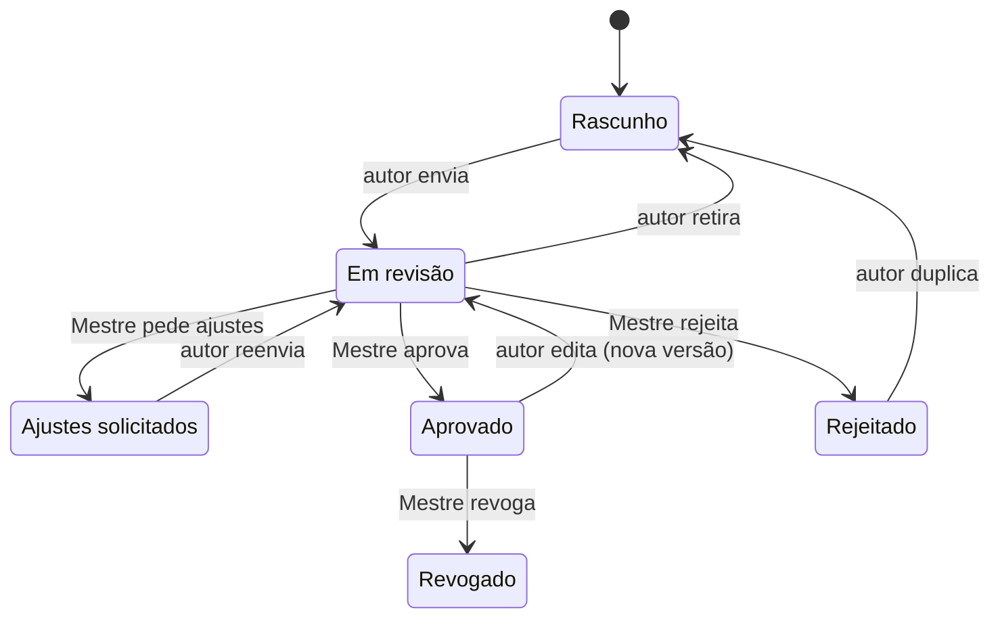
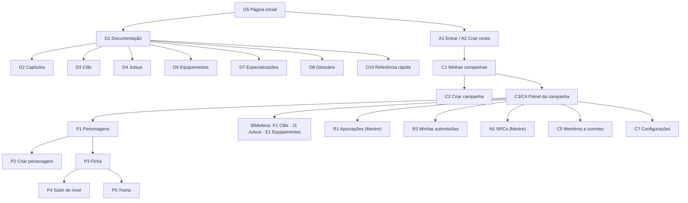
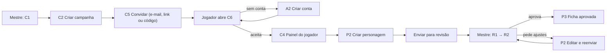
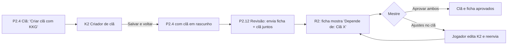
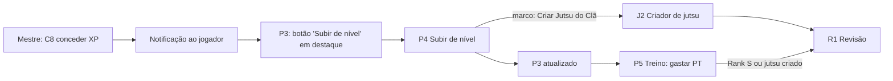
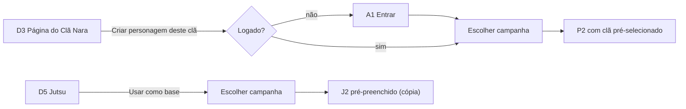
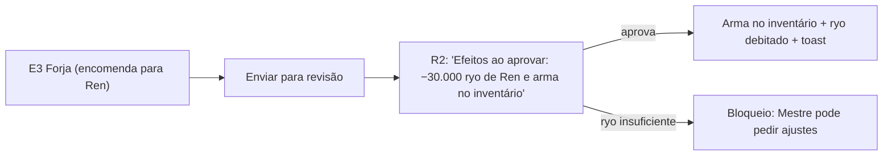

# Shinobi no Michi — Guia de Interfaces para o Claude Design

> Documento-base para criar, no Claude Design, **todas as telas** da **Documentação Web** e do **Criador de Campanhas** do RPG de mesa *Shinobi no Michi — O Caminho do Ninja* (Livro de Regras v18.0).
>
> Projeto: `risingShinobi` · Implementação futura: SvelteKit + Tailwind CSS + DaisyUI · Ícones personalizados: PixelLab · Idioma da interface: português do Brasil.

## Sumário

0. [Como usar este documento](#0-como-usar-este-documento)
1. [Visão do produto](#1-visão-do-produto)
2. [Identidade visual](#2-identidade-visual)
3. [Ícones personalizados (PixelLab)](#3-ícones-personalizados-pixellab)
4. [Biblioteca de componentes](#4-biblioteca-de-componentes)
5. [Padrões globais: estados, feedback e validação](#5-padrões-globais-estados-feedback-e-validação)
6. [Navegação e fluxos](#6-navegação-e-fluxos)
7. [Especificação das telas](#7-especificação-das-telas)
8. [Responsividade](#8-responsividade)
9. [Dados de exemplo para os mockups](#9-dados-de-exemplo-para-os-mockups)
10. [Roteiro de produção no Claude Design](#10-roteiro-de-produção-no-claude-design)
11. [Checklist de consistência](#11-checklist-de-consistência)
- [Apêndice A — Regras que a interface calcula e valida](#apêndice-a--regras-que-a-interface-calcula-e-valida)

---

## 0. Como usar este documento

### 0.1 Ordem recomendada

1. Gerar no PixelLab o **conjunto-semente** e os ícones de prioridade **P1** (seção 3). Se ainda não existirem, usar os placeholders da seção 3.8.
2. Criar no Claude Design o **quadro do design system**: tokens, tipografia, componentes (seções 2 e 4). É o lote 0.
3. Produzir as telas em lotes (seção 10), colando o **Contexto fixo** (10.1) no início de cada sessão.

### 0.2 Convenções

- Cada tela tem um **ID** (ex.: `P2`). Subpassos usam ponto (ex.: `P2.5`). Os IDs aparecem nos fluxos, nas rotas e nos nomes dos frames.
- Nome de frame: `ID · Nome · Dispositivo · Estado`. Exemplo: `P2.5 · Perícias · Mobile · Erro`.
- **Mestre** é o narrador da mesa, um papel dentro de cada campanha. Na interface, o papel aparece sempre como badge "Mestre" com ícone próprio. Isso evita confusão com o nível de proficiência "Mestre (+4)" e com "Mestre Ferreiro".
- As siglas do livro aparecem sem tradução (PV, PC, PE, PT, PD, DT, RD, PIC, PJ, PB, PKG, PFo, KKG), sempre com tooltip de glossário (componente CMP-22).
- Termos japoneses seguem a grafia do livro, com macrons: Dōjō, Hyōton, Dōjutsu, Kekkei Genkai.
- **Oficial** = conteúdo do livro. **Da campanha** = conteúdo criado dentro de uma campanha (homebrew).

---

## 1. Visão do produto

### 1.1 Dois produtos, uma casa

| | Documentação Web | Criador de Campanhas |
|---|---|---|
| O que é | O Livro de Regras v18 navegável, pesquisável, com catálogos filtráveis | Ferramenta para Mestres e jogadores criarem e gerenciarem campanhas, personagens e conteúdo |
| Acesso | Público, sem login | Exige conta |
| Uso típico | Consultar uma regra no meio da sessão; aprender o sistema | Montar a ficha, propor clã/jutsu/arma, revisar submissões, acompanhar o grupo |
| Ponte entre os dois | Botões contextuais ("Criar personagem deste clã", "Usar como base") levam ao criador | Toda regra citada no criador tem link para a seção correspondente da documentação |

### 1.2 Papéis e permissões

O papel vale **por campanha**: a mesma pessoa pode ser Mestre em uma campanha e Jogador em outra.

| Ação | Visitante | Jogador | Mestre |
|---|:-:|:-:|:-:|
| Ler documentação, catálogos e glossário | ✓ | ✓ | ✓ |
| Criar campanha (quem cria vira Mestre) | — | ✓ | ✓ |
| Convidar e remover membros | — | — | ✓ |
| Criar e editar o próprio personagem | — | ✓ | ✓ |
| Ver a ficha completa de outros personagens | — | Só o resumo público | ✓ |
| Criar clã, jutsu, habilidade, arma, item, marionete | — | ✓ (vai para revisão) | ✓ (publica direto) |
| Aprovar, pedir ajustes, rejeitar, revogar | — | — | ✓ |
| Conceder XP, PT, ryo; renovar PD e PIC | — | — | ✓ |
| Criar e ver NPCs | — | Só os revelados | ✓ |
| Configurar, arquivar, transferir ou excluir a campanha | — | — | ✓ |

### 1.3 Princípios de experiência

1. **A regra está sempre a um clique.** Todo número calculado e toda validação mostram a origem ("cap. 6, Passo 8") com link para a documentação.
2. **O sistema calcula, o jogador decide.** PV, PC, PE, Defesa, Rank e custo de jutsu, carga e orçamentos são automáticos, e o detalhamento ("como foi calculado") fica sempre visível.
3. **O Mestre tem a palavra final, e isso fica visível.** Todo conteúdo homebrew mostra seu status de aprovação. Exceções concedidas pelo Mestre ficam marcadas para sempre.
4. **Leitura em primeiro lugar.** A pixel art dá identidade; textos, tabelas e números são sempre nítidos.
5. **Nada se perde.** Rascunhos salvam sozinhos. Ações destrutivas pedem confirmação proporcional ao estrago.
6. **Conteúdo real nos mockups.** Use as tabelas, jutsus, clãs e NPCs do livro (seção 9), nunca lorem ipsum.

### 1.4 Fora do escopo desta etapa

- Ferramentas de mesa virtual: mapa tático, rolador de dados, rastreador de iniciativa, chat.
- Editor do conteúdo do livro (a documentação é gerada a partir do livro, sem interface de edição).
- Monetização e app nativo.
- Upload livre de imagens, exceto o avatar opcional do usuário (ver 3.7).

### 1.5 Restrições técnicas que afetam o design

- Componentes compostos a partir do **DaisyUI 5 + Tailwind**. Os tokens de cor viram um tema DaisyUI (seção 2.2). Evitar padrões que exijam bibliotecas pesadas, como arrastar-e-soltar complexo ou canvas.
- Ícones são **PNG em pixel art**, exibidos apenas em escalas inteiras (seção 3.3).
- Fontes do Google Fonts.
- Cada tela tem uma rota (seção 6.1). Modais que representam conteúdo, como o detalhe de um jutsu, também têm URL própria.

---

## 2. Identidade visual

### 2.1 Conceito: "Pergaminho, tinta e selo"

A identidade nasce do próprio livro de regras, que já usa fundo de pergaminho, cabeçalhos de tabela em vermelhão e faixas grená nos cards de jutsu. São quatro materiais:

- **Washi (pergaminho):** fundos quentes e claros, com textura muito sutil.
- **Sumi (tinta):** texto e contornos quase pretos. O tema escuro inteiro é "tinta".
- **Hanko (selo):** vermelhão para a ação principal, os ranks e a aprovação. O carimbo é o gesto do Mestre ao aprovar.
- **Pixel art:** ícones e ilustrações do PixelLab com contorno de tinta, como carimbos ou xilogravuras de 8 bits.

**Evitar:** fontes "pincel" ou "ninja" caricatas, neon, gradientes brilhantes, pinceladas fotográficas misturadas com pixel art e kanji decorativo sem significado.

### 2.2 Paleta e tokens (tema DaisyUI)

**Tema claro `washi` (padrão)**

| Token | Hex | Uso |
|---|---|---|
| `base-100` | `#FBF7F0` | Fundo da página, cards |
| `base-200` | `#F4E4D6` | Pergaminho: linhas alternadas de tabela, painéis laterais, bloco de fórmula |
| `base-300` | `#E6D2BF` | Bordas fortes, separadores, trilho de barras |
| `base-content` | `#1A1A1A` | Texto principal (sumi) |
| `muted` (custom) | `#5C524A` | Texto secundário, legendas |
| `link` (custom) | `#8B2E20` | Links dentro do texto |
| `primary` / content | `#C44536` / `#FFFFFF` | Vermelhão: ação principal, cabeçalho de tabelas, foco, item ativo |
| `secondary` / content | `#5C1E15` / `#F4E4D6` | Grená: faixa do card de jutsu, cabeçalho de clã, destaques estruturais |
| `accent` / content | `#BF9000` / `#1A1A1A` | Ouro: rank S, qualidade Lendária, conquistas |
| `neutral` / content | `#2B2320` / `#F4E4D6` | Superfícies escuras no tema claro (tooltip, dock mobile) |
| `info` / content | `#2D6A9F` / `#FFFFFF` | Informação, status "Ajustes solicitados" |
| `success` / content | `#2F7A4F` / `#FFFFFF` | Sucesso, status "Aprovado" |
| `warning` / content | `#C98A00` / `#1A1A1A` | Avisos de regra, status "Em revisão" |
| `error` / content | `#9B1C1C` / `#FFFFFF` | Erros, bloqueios de regra, status "Rejeitado" |

**Tema escuro `sumi`**

| Token | Hex | Uso |
|---|---|---|
| `base-100` | `#16110F` | Fundo |
| `base-200` | `#1F1815` | Painéis, linhas alternadas |
| `base-300` | `#2E2420` | Bordas, trilhos |
| `base-content` | `#EFE3D3` | Texto principal |
| `muted` | `#B5A797` | Texto secundário |
| `link` | `#E8806F` | Links no texto |
| `primary` / content | `#C44536` / `#FFFFFF` | Igual ao claro |
| `secondary` / content | `#5C1E15` / `#F4E4D6` | Com borda de 1px `#8B2E20` para destacar do fundo |
| `accent` / content | `#D9A82B` / `#16110F` | |
| `neutral` / content | `#0E0B0A` / `#EFE3D3` | |
| `info` / `success` / `warning` / `error` | `#5B9BD5` / `#4FA373` / `#E0A82E` / `#E5534B` | Sempre com texto `#16110F` sobre a cor |

**Contrastes verificados (aproximados):**
- branco sobre `#C44536` ≈ 4,9:1 ✓ (botões);
- `#C44536` sobre `#F4E4D6` ≈ 4,0:1 → **apenas** texto grande (≥ 24px, ou ≥ 19px em negrito) e elementos de UI, nunca texto corrido;
- `#8B2E20` sobre `#F4E4D6` ≈ 6,8:1 ✓ (por isso os links usam grená, não vermelhão);
- `#F4E4D6` sobre `#5C1E15` ≈ 10:1 ✓;
- `#E8806F` sobre `#16110F` ≈ 6,9:1 ✓.

**Vermelhão × erro:** como a cor da marca é vermelha, erro usa um carmim mais escuro (`#9B1C1C`) **sempre** acompanhado de ícone, texto e fundo tingido. Botões destrutivos usam o estilo *outline* de erro; o preenchimento sólido aparece só no botão de confirmação final.

Referência de implementação (DaisyUI 5):

```css
@plugin "daisyui/theme" {
  name: "washi";
  default: true;
  color-scheme: light;
  --color-base-100: #FBF7F0;
  --color-base-200: #F4E4D6;
  --color-base-300: #E6D2BF;
  --color-base-content: #1A1A1A;
  --color-primary: #C44536;
  --color-primary-content: #FFFFFF;
  --color-secondary: #5C1E15;
  --color-secondary-content: #F4E4D6;
  --color-accent: #BF9000;
  --color-accent-content: #1A1A1A;
  --color-neutral: #2B2320;
  --color-neutral-content: #F4E4D6;
  --color-info: #2D6A9F;
  --color-info-content: #FFFFFF;
  --color-success: #2F7A4F;
  --color-success-content: #FFFFFF;
  --color-warning: #C98A00;
  --color-warning-content: #1A1A1A;
  --color-error: #9B1C1C;
  --color-error-content: #FFFFFF;
  --radius-selector: 0.125rem;
  --radius-field: 0.25rem;
  --radius-box: 0.5rem;
  --border: 1px;
  --depth: 0;
  --noise: 1;
}
```

### 2.3 Cores de domínio

**Regra geral:** cor nunca é o único sinal. Tipo, elemento, rank e status aparecem sempre com **ícone + texto**.

**Tipos de jutsu.** São as cores que o livro já usa nos cards; Kugutsu é uma proposta nova.

| Tipo | Cor | Texto sobre a cor | Recurso gasto | Perícia rolada |
|---|---|---|---|---|
| Ninjutsu | `#069BBD` | `#1A1A1A` | PC | Ninjutsu |
| Genjutsu | `#674EA7` | `#FFFFFF` | PC | Genjutsu |
| Taijutsu | `#38761D` | `#FFFFFF` | PE | Taijutsu |
| Bukijutsu | `#BF9000` | `#1A1A1A` | PE | Bukijutsu |
| Fuuinjutsu | `#7F6000` | `#FFFFFF` | PC | Selamento |
| Kugutsu | `#A23B72` *(proposta; o livro não tem card de Kugutsu)* | `#FFFFFF` | PC + PE | Kugutsu |

**Elementos.** Chips com fundo da cor a 12% de opacidade, ícone colorido e texto em `base-content`, o que garante o contraste.

| Básicos | Cor | Kekkei Genkai elementais | Cor |
|---|---|---|---|
| Katon (Fogo) | `#E8692E` | Mokuton (Madeira = Terra + Água) | `#4E7A2E` |
| Suiton (Água) | `#2E6FD1` | Hyōton (Gelo = Vento + Água) | `#7FD3E6` |
| Doton (Terra) | `#8D6E3F` | Yōton (Lava = Fogo + Terra) | `#B23A12` |
| Raiton (Raio) | `#F2C14E` | Ranton (Tempestade = Raio + Água) | `#3A5BA0` |
| Fuuton (Vento) | `#7FB069` | Jiton (Magnético = Vento + Terra) | `#5E6B73` |

**Selos de rank.** A intensidade cresce de E até S, sem criar matizes novos.

| Rank | Fundo do selo | Letra | Faixa de PJ | Quem usa (glossário) |
|---|---|---|---|---|
| E | `#E6D2BF` | `#5C524A` | 1–2 | Acadêmicos |
| D | `#A88B6A` | `#1A1A1A` | 3–5 | Genin |
| C | `#5E6B73` | `#FFFFFF` | 6–10 | Chunin |
| B | `#5C1E15` | `#F4E4D6` | 11–18 | Jounin |
| A | `#C44536` | `#FFFFFF` | 19–30 | Jounin de elite, Anbu |
| S | `#1A1A1A`, borda `#BF9000` | `#F2C14E` | 31+ | Kage, Sannin, lendas |

**Recursos (barras da ficha):** PV `#C44536` · PC `#2D7FB8` · PE `#D29A1E` · PD `#BF9000` (estrelas) · Fadiga em 5 pips que escurecem de `#5C524A` até `#9B1C1C`.

### 2.4 Tipografia

| Papel | Fonte | Peso | Desktop (tamanho/entrelinha) | Mobile |
|---|---|---|---|---|
| Display (landing, capas) | Shippori Mincho B1 | 800 | 48/56 | 36/44 |
| H1 (página, capítulo) | Shippori Mincho B1 | 700 | 36/44 | 28/36 |
| H2 | Shippori Mincho B1 | 700 | 28/36 | 24/32 |
| H3 | Shippori Mincho B1 | 600 | 22/30 | 20/28 |
| H4 / rótulo de seção | Noto Sans | 700, caixa-alta, tracking 0,06em | 14/20 | 14/20 |
| Corpo de leitura (docs) | Noto Sans | 400 | 17/29, até 72 caracteres por linha | 16/27 |
| Corpo de interface | Noto Sans | 400 | 15/22 | 15/22 (campos de formulário: 16px) |
| Pequeno | Noto Sans | 400–500 | 14/20 | 14/20 |
| Legenda (mínimo absoluto) | Noto Sans | 500 | 12/16 | 12/16 |
| Números de destaque (atributo, nível, letra do selo) | Pixelify Sans | 500–700 | 20–40 | 20–32 |
| Kanji decorativo | Shippori Mincho B1 | 800 | livre | livre |

- Kanji usam `Noto Sans JP` como fallback.
- Números em tabelas, fichas e contadores usam algarismos tabulares (`tabular-nums`).
- **Pixelify Sans** só em números e letras curtas a partir de 20px. Nunca em frases.
- Itálico só para a tradução do nome do jutsu ("Técnica de Imitação da Sombra") e para epígrafes.

### 2.5 Grid, espaçamento e forma

- Base de 4px. Escala: 4 · 8 · 12 · 16 · 24 · 32 · 48 · 64.
- Containers: app até 1280px; documentação até 1440px em três colunas (sumário 280px · conteúdo até 760px · "nesta página" 220px).
- Gutters: 24px no desktop, 20px no tablet, 16px no mobile.
- Raios: 2px em badges e selos (quase quadrados, como carimbos); 4px em campos e botões; 8px em cards e modais.
- Bordas: 1px `base-300`. Cards de destaque: 1px `secondary` a 30%.
- Sombras quase inexistentes ("papel sobre papel"): borda mais `0 1px 0`. Modais usam sombra difusa quente `rgba(43,35,32,.18)`.
- Textura: ruído sutil do DaisyUI (`--noise`) apenas em superfícies grandes de `base-200` (hero, sidebar). Nunca atrás de texto corrido longo.

### 2.6 Motivos decorativos

- **Faixa grená** no topo dos cards de jutsu e habilidade e no cabeçalho das páginas de clã, como no livro.
- **Cabeçalho de tabela em vermelhão** com texto branco; linhas alternando `base-100` e `base-200`.
- **Selo (hanko)** para rank e aprovação.
- **Divisor duplo:** duas linhas de 1px em `secondary` a 25%, separadas por 2px, entre seções grandes.
- **Numeral em kanji** atrás do título de cada capítulo, grande, em `base-300`, oculto para leitores de tela: 一 二 三 四 五 六 七 八 九 十 十一 十二 十三 十四 十五 十六 十七 十八 十九 二十 二十一 二十二 二十三 (capítulos 1 a 23).
- **Epígrafes:** as citações do livro abrem capítulos e clãs.
- **Rodapé:** 「忍道」 + "Que o seu Caminho do Ninja seja repleto de aventuras!" (frase final do livro).
- **Moldura pixel 9-slice** (PixelLab, P3) reservada a momentos especiais: subir de nível, boas-vindas, aprovação.

### 2.7 Movimento

- Durações: 120ms (hover), 200ms (abrir e fechar), 300ms (troca de passo ou página). Easing *ease-out*.
- **Momento-assinatura, o carimbo:** ao enviar ou aprovar, o selo desce (escala 1,15 → 1; rotação −6° → −3°) em 250ms, com um tremor de 1px.
- **Valores calculados:** contagem rápida (150ms) ao mudar, com realce de fundo em `base-200` por 600ms.
- **Carregamento:** sprite de shuriken girando (8 quadros) para ações acima de 2s; skeleton para conteúdo.
- Com `prefers-reduced-motion`: sem rotação nem contagem, trocas instantâneas, e o carimbo vira fade.

### 2.8 Voz e microcopy

- Português do Brasil, falando com "você", de forma direta. Botões no infinitivo: "Salvar rascunho", "Enviar para revisão".
- Termos do livro sempre: Mestre, ficha, PV, ryo, jutsu, clã/clãs, Kekkei Genkai.
- O tom temático aparece só em estados vazios, sucessos e boas-vindas. Erros e validações são literais e dizem o que fazer.
- Formatos: "14.000 ryo"; "1d20 + Ninjutsu"; "16 out. 2026"; "há 3 min".

| Situação | Texto |
|---|---|
| Notificações vazias | "Nenhum corvo mensageiro por aqui." |
| Fila de revisão vazia | "Nada para revisar. Hora do chá, Mestre." |
| Ficha enviada | "Ficha enviada! O Mestre foi avisado." |
| Aprovação | "Selo aplicado. “Lança de Gelo” agora faz parte da campanha." |
| Falha ao salvar | "Não foi possível salvar. Suas alterações continuam neste dispositivo. [Tentar de novo]" |
| Bloqueio de regra | "Atributos não passam de +4 na criação (+5 com bônus de clã). · cap. 6, Passo 2" |
| Convite expirado | "Este convite expirou. Peça um novo link ao Mestre." |

### 2.9 Acessibilidade (WCAG 2.2 AA)

- Contrastes conforme 2.2. Vermelhão como texto só em tamanho grande.
- Foco visível: anel de 2px `primary` com 2px de afastamento (no tema escuro, `#E8806F`).
- Tudo navegável por teclado. Steppers aceitam ↑/↓ e digitação. `Ctrl/⌘ + K` abre a busca e `Esc` fecha camadas.
- Totais recalculados são anunciados com `aria-live="polite"` (ex.: "PV recalculado: 30").
- Alvos de toque com pelo menos 44×44px e 8px entre eles.
- Texto ampliável até 200% sem cortes. Tabelas com cabeçalhos semânticos.
- Ícones decorativos com `alt` vazio. Ícones com significado têm rótulo (o manifesto de ícones traz o texto alternativo).
- Formulários com rótulo sempre visível (placeholder não substitui rótulo). Erro abaixo do campo, com ícone e texto.

---

## 3. Ícones personalizados (PixelLab)

### 3.1 Estilo-mestre

| Parâmetro | Definição |
|---|---|
| Linguagem | Pixel art "carimbo de tinta": silhueta forte, leitura imediata |
| Contorno | 1px, cor única `#1A1A1A` (no PixelLab: *single color outline*) |
| Sombreamento | Médio, 2–3 tons por material (*medium shading*) |
| Detalhe | Médio em 32px; baixo em 16px |
| Luz | Vinda do canto superior esquerdo, em todos os ícones |
| Vista | Objetos em vista frontal ou levemente de cima (*low top-down*); símbolos (vilas, kamon) frontais e chapados |
| Fundo | Transparente; sem sombra projetada no chão |
| Margem de segurança | 2px em 32×32; 1px em 16×16 |
| Leitura nos dois temas | Testar cada ícone sobre `#FBF7F0` e sobre `#16110F`. O contorno escuro precisa de um realce interno claro para não sumir no tema escuro |
| Proibido | Anti-aliasing, gradientes suaves, texto/letras (exceto selos de rank, os kanji dos símbolos canônicos como 火, o 可 do selo de aprovação e o 承認 da ilustração), personagens canônicos reconhecíveis |

### 3.2 Paleta de pixel

Restringir os ícones a esta paleta (forçar no PixelLab com imagem de paleta ou referência de cor). Se um ícone realmente precisar, aceita até 2 cores extras, que devem ser registradas.

`#1A1A1A` contorno · `#2B1A14` sombra quente · `#5C1E15` grená · `#8B2E20` grená claro · `#C44536` vermelhão · `#E07A5F` realce vermelho · `#FBF7F0` papel claro · `#F4E4D6` pergaminho · `#D9C2A7` sombra de papel · `#A88B6A` papel profundo · `#BF9000` ouro · `#F2C14E` ouro claro · `#069BBD` chakra · `#7FD3E6` chakra claro · `#38761D` verde · `#7FB069` verde claro · `#674EA7` roxo · `#A895D6` roxo claro · `#7F6000` terra escura · `#8D6E3F` terra · `#5E6B73` aço · `#A7B4BC` aço claro · `#E8692E` fogo · `#2E6FD1` água · `#FFFFFF` brilho.

### 3.3 Tamanhos e renderização

| Tamanho nativo | Uso | Exibição permitida |
|---|---|---|
| 16×16 | Inline no texto, badges, tabelas, chips, dock compacto | 16 (1×), 32 (2×) |
| 32×32 (**padrão**) | Navegação, cards, botões com ícone, steppers, cabeçalhos | 32, 64, 96 |
| 96×96 | Ilustrações de estado (vazio, erro, sucesso) | 96, 192 |
| 64×64 | Retratos de avatar | 64, 128 |
| 256×96 | Capas de campanha | 256, 512, 768 |

- **Só escalas inteiras.** Nunca 24px a partir de um ícone 16 ou 32, porque fica borrado.
- Os ícones de 16px são **redesenhados** (versões simplificadas), não reduções do de 32.
- CSS obrigatório: `image-rendering: pixelated`.

### 3.4 Processo de geração

A fonte única dos prompts e da ordem é `pixellab/icones-p1.json` (versão legível em `pixellab/prompts-p1.md`). A prancha de revisão é gerada por `pixellab/scripts/gerar-prancha.js`.

**Regra canônica:** símbolos que existem no mangá/anime (vilas, brasões de clã, ícones de natureza do chakra) são **recriações fiéis dos originais**, nunca motivos inventados. Pipeline: SVG oficial da wiki Naruto (`scripts/fetch-ref.js`) → base 32px na paleta (`scripts/canon.js`) → PixelLab `create_image_pixflux` em img2img (força 180–300) → revisão. Motivos inventados só onde não existe símbolo canônico.

1. **Conjunto-semente** (pronto): `ic-recurso-pc`, `ic-elemento-katon` (canônico, 火), `ic-pericia-taijutsu`, `ic-vila-konoha` (canônico), `ic-status-aprovado` (selo com 可, desenhado em código), `ic-nav-jutsus`.
2. Usar o conjunto aprovado como **referência de estilo** (`style_images`) em todas as gerações seguintes.
3. Ícones comuns saem em lote: `create_1_direction_object` com `size: 32`, paleta forçada e até 64 `item_descriptions` por chamada (10–25 gerações por chamada).
4. Letras e emblemas geométricos sem referência oficial (selos de rank) são desenhados em código: o texto-para-imagem erra símbolos (o primeiro selo saiu com um "$").
5. Ícones que vierem sem contorno recebem o contorno de 1px em código (`pngtool.js outline`).
4. Revisar cada lote numa prancha: todos lado a lado, nos dois temas, em 1× e 2×. Conferir silhueta, luz, espessura do contorno e paleta.
5. Limpar à mão os pixels soltos e exportar.

### 3.5 Nomenclatura, pastas e exportação

- Nome: `ic-{categoria}-{nome}-{tamanho}.png`, em minúsculas, sem acento, com hífens. Ex.: `ic-elemento-katon-32.png`, `ic-status-em-revisao-16.png`.
- Ilustrações: `il-{nome}-96.png`. Animações: `an-{nome}-32.png`, em sprite sheet horizontal com N quadros + `an-{nome}.json` (quadros e fps).
- Pastas: `static/icons/{categoria}/`, `static/illustrations/`, `static/animations/`.
- PNG de 32 bits com transparência, sem reamostragem, sem metadados de cor.
- Manifesto `static/icons/icons.json` com, para cada ícone: `id`, `categoria`, `tamanhos`, `alt` (texto alternativo em pt-BR) e `prioridade`.
- **Pacote para o Claude Design:** `pixellab/icones-shinobi-claude-design.zip` (gerado por `node pixellab/scripts/exportar.js`). Contém pranchas por categoria com o ID embaixo de cada ícone (temas Washi e Sumi), PNGs já ampliados sem suavização (ícones 32/64/96, ilustrações 96/192, capas 256/512), `icons.json` e `LEIA-ME.md` com a regra de uso a colar no contexto.
- Observação: símbolos de vilas e clãs são da franquia Naruto. Para um projeto de fãs não há problema; se o projeto virar comercial, isso precisa ser revisto.

### 3.6 Inventário completo

Prioridade: **P1** = necessário para o MVP das telas · **P2** = enriquece · **P3** = refinamento.

**3.6.1 Marca**

| ID | Motivo sugerido | Onde | Tamanhos | Prio |
|---|---|---|---|---|
| `marca` | Placa metálica de hitaiate com shuriken gravado e faixa vermelhão | Logo na navbar, favicon (16/32/48), ícone de app (192/512 por upscale inteiro do 64) | 16, 32, 64 | P1 |

**3.6.2 Navegação e áreas**

| ID | Motivo | Onde | Prio |
|---|---|---|---|
| `nav-regras` | Pergaminho aberto com fita vermelha | Navbar, dock | P1 |
| `nav-campanhas` | Mapa de missão enrolado com selo | Navbar, dock | P1 |
| `nav-personagens` | Busto ninja com hitaiate (silhueta) | Menu da campanha | P1 |
| `nav-clas` | Estandarte nobori com kamon genérico | Menu da campanha | P1 |
| `nav-jutsus` | Mãos fazendo selo | Menu da campanha | P1 |
| `nav-equipamentos` | Kunai e shuriken cruzados | Menu da campanha | P1 |
| `nav-npcs` | Máscara branca lisa com marcas vermelhas genéricas | Menu da campanha (Mestre) | P1 |
| `nav-aprovacoes` | Selo hanko com tinta | Menu da campanha (Mestre) | P1 |
| `nav-submissoes` | Pergaminho com seta de envio | Menu da campanha (Jogador) | P1 |
| `nav-membros` | Três hitaiates pequenos | Menu da campanha | P1 |
| `nav-configuracoes` | Engrenagem de bronze com fita | Menu da campanha, perfil | P1 |
| `nav-notificacoes` | Corvo mensageiro | Navbar, dock | P1 |
| `nav-perfil` | Placa de nome de madeira (nafuda) | Menu do usuário | P1 |
| `nav-referencia` | Biombo dobrável (byōbu), o "escudo do Mestre" | Docs, Referência rápida | P1 |

**3.6.3 Partes do livro** (32px; exibidos também em 64px)

| ID | Motivo | Prio |
|---|---|---|
| `parte-1` | Kunai cruzadas sobre pergaminho (Fundamentos, Combate e Sombra) | P1 |
| `parte-2` | Máscara e pincel (Criando seu Personagem) | P1 |
| `parte-3` | Bolsa ninja com pergaminho e kunai (Recursos do Ninja) | P1 |
| `parte-4` | Portão de madeira fechado (Avanços de Poder) | P1 |
| `parte-5` | Broto nascendo de um poste de treino (Crescimento) | P1 |
| `parte-6` | Pincel e martelo de forja cruzados sobre pergaminho (Criação Avançada) | P1 |
| `parte-referencia` | Livro com marcadores | P1 |

**3.6.4 Atributos**

| ID | Motivo | Prio |
|---|---|---|
| `atributo-for` | Braço flexionado com faixa vermelha | P1 |
| `atributo-agi` | Sandália com rajada de vento | P1 |
| `atributo-vig` | Toco de árvore com raízes profundas | P1 |
| `atributo-int` | Olho sobre pergaminho aberto | P1 |
| `atributo-ctr` | Ponta do dedo equilibrando uma esfera de chakra | P1 |
| `atributo-esp` | Chama azul de espírito | P1 |

**3.6.5 Recursos e valores derivados**

| ID | Motivo | Prio |
|---|---|---|
| `recurso-pv` | Coração vermelhão | P1 |
| `recurso-pc` | Espiral de chakra azul | P1 |
| `recurso-pe` | Gota de energia âmbar com faísca | P1 |
| `recurso-pt` | Poste de treino de madeira | P1 |
| `recurso-pd` | Estrela dourada de quatro pontas com fita | P1 |
| `recurso-xp` | Pergaminho de missão com estrela | P1 |
| `recurso-ryo` | Moeda oval dourada com furo quadrado | P1 |
| `recurso-pic` | Amuleto omamori vermelho | P1 |
| `recurso-fadiga` | Rosto cansado de olhos fechados com gota de suor | P1 |
| `recurso-rd` | Placa de armadura | P1 |
| `recurso-defesa` | Escudo de madeira | P1 |
| `recurso-defesa-mental` | Olho dentro de um escudo | P1 |
| `recurso-iniciativa` | Kunai sendo sacada do coldre, com linhas de movimento | P1 |
| `recurso-carga` | Mochila de viagem | P1 |

**3.6.6 Perícias** (também usadas como ícone de **tipo de jutsu**: Ninjutsu, Genjutsu, Taijutsu, Bukijutsu e Kugutsu reaproveitam os de mesmo nome; Fuuinjutsu usa `pericia-selamento`)

| ID | Motivo | Prio |
|---|---|---|
| `pericia-acrobacia` | Figura em salto mortal | P1 |
| `pericia-atletismo` | Corda de escalada enrolada | P1 |
| `pericia-bukijutsu` | Katana no meio do golpe, com rastro branco | P1 |
| `pericia-furtividade` | Pegadas sumindo na sombra | P1 |
| `pericia-genjutsu` | Olho com espiral roxa | P1 |
| `pericia-investigacao` | Lupa sobre pergaminho | P1 |
| `pericia-kugutsu` | Marionete de madeira com fios azuis | P1 |
| `pericia-medicina` | Mão com brilho verde | P1 |
| `pericia-ninjutsu` | Palma aberta segurando uma esfera de energia | P1 |
| `pericia-percepcao` | Orelha e olho atentos | P1 |
| `pericia-persuasao` | Leque aberto | P1 |
| `pericia-rastreamento` | Trilha de pegadas de cão | P1 |
| `pericia-selamento` | Pergaminho com selo em espiral | P1 |
| `pericia-sobrevivencia` | Fogueira com panela | P1 |
| `pericia-taijutsu` | Punho com faixas de treino | P1 |

**3.6.7 Elementos** — **canônicos**

Ícones oficiais de natureza do chakra (octógono com o kanji do elemento: 火 水 土 雷 風), recriados em pixel art. Básicos (Katon, Suiton, Doton, Raiton, Fuuton) **P1**; Kekkei Genkai (Mokuton, Hyōton, Yōton, Ranton, Jiton) **P2**.

**3.6.8 Selos de rank** (16 e 32px; letra desenhada em pixel)

`rank-e`, `rank-d`, `rank-c`, `rank-b`, `rank-a`, `rank-s`: carimbo quadrado de cantos levemente arredondados com a letra no centro, nas cores da seção 2.3. O rank S ganha borda dourada e um brilho de 1px. **P1**.

**3.6.9 Status de aprovação** (16 e 32px)

| ID | Motivo | Prio |
|---|---|---|
| `status-rascunho` | Pincel com ponta molhada | P1 |
| `status-em-revisao` | Incenso queimando com fumaça | P1 |
| `status-ajustes` | Pergaminho com traço de pincel vermelho | P1 |
| `status-aprovado` | Selo hanko vermelho com o kanji 可 | P1 |
| `status-rejeitado` | Pergaminho rasgado | P1 |
| `status-revogado` | Selo riscado | P2 |
| `status-excecao-mestre` | Selo com estrela dourada | P2 |

**3.6.10 Papéis:** `papel-mestre` (leque de guerra gunbai) e `papel-jogador` (faixa de hitaiate amarrada em nó). **P1**.

**3.6.11 Vilas** (32px; exibidos também em 64px no seletor) — **canônicos**

Os 8 símbolos oficiais das vilas (Konoha, Suna, Kiri, Kumo, Iwa, Ame, Taki, Oto), recriados a partir dos SVGs da wiki e aplicados sobre aço, como a placa do hitaiate. `vila-sem` = hitaiate riscado dos ninjas renegados. **P1**.

**3.6.12 Clãs** — **canônicos**

| ID | Fonte | Prio |
|---|---|---|
| `cla-nara`, `cla-akimichi`, `cla-yamanaka`, `cla-inuzuka`, `cla-aburame`, `cla-hyuuga`, `cla-uchiha`, `cla-senju`, `cla-uzumaki`, `cla-kaguya`, `cla-hozuki`, `cla-yuki` | Brasão oficial do clã (SVG da wiki), recriado em pixel art | P1 |
| `cla-sabaku` | Sem brasão oficial: cabaça de areia do Gaara | P1 |
| `kamon-base-01` … `kamon-base-12` | Brasões genéricos para clãs da campanha: folha, leque, onda, chama, montanha, nuvem, lua, osso, inseto, olho, espiral, lâmina. **Uma cor só (branco) sobre transparente**, para serem tingidos via CSS `mask-image` com a cor do clã | P1 |

**3.6.13 Tipos de Kekkei Genkai:** `kkg-dojutsu` (olho), `kkg-corporal` (braço com osso exposto estilizado), `kkg-mental` (cabeça com ondas), `kkg-combinacao` (dois elementos se fundindo), `kkg-hibrido` (espiral com inseto). **P1**.

**3.6.14 Especializações** (16 ícones, **P1**)

`esp-controle-chakra` (fio de chakra passando pelo buraco de uma agulha) · `esp-reservatorio` (cabaça cheia de chakra) · `esp-elemento` (cinco pontos elementais em círculo) · `esp-velocidade` (silhueta de ninja correndo com linhas de velocidade) · `esp-resistencia` (protetor de antebraço de ferro) · `esp-genjutsu` · `esp-ninjutsu` · `esp-bukijutsu` · `esp-taijutsu` (os quatro anteriores reaproveitam o motivo da perícia dentro de um medalhão) · `esp-selamento` (pergaminho com corrente) · `esp-furtividade` (lâmina na sombra) · `esp-marionete` (cabeça de marionete) · `esp-invocacao` (nuvem de fumaça com selo) · `esp-sensor` (ondas concêntricas de chakra) · `esp-medico` (pílula com brilho verde) · `esp-sennin` (pedra com musgo e energia verde).

**3.6.15 Módulos especiais da ficha** (**P2**)

`modulo-companheiro` (pata) · `modulo-invocacao` (reaproveita `esp-invocacao`) · `modulo-marionete` (reaproveita `pericia-kugutsu`) · `modulo-portoes` (portão com oito trancas) · `modulo-sennin` (reaproveita `esp-sennin`) · `modulo-mangekyou` (olho vermelho com padrão estrelado genérico).

**3.6.16 Equipamento**

| Grupo | IDs | Prio |
|---|---|---|
| Categorias | `equip-arma-distancia` (shuriken), `equip-arma-curta` (tanto), `equip-arma-longa` (katana), `equip-arma-exotica` (kusarigama), `equip-sete-espadas` (espadão enfaixado), `equip-pilula`, `equip-veneno` (frasco roxo), `equip-pergaminho`, `equip-kit` (bolsa), `equip-ferramenta` (rolo de fio) | P1 |
| Armas do catálogo | shuriken, kunai, senbon, fuuma-shuriken, arco-longo, tanto, wakizashi, kodachi, nunchaku, katana, nodachi, naginata, bo, yari, kusarigama, manriki, tonfa, sai, hanbo, kanabo | P2 |
| Sete Espadas | kubikiribocho, samehada, hiramekarei, kabutowari, nuibari, shibuki, kiba | P2 |
| Itens do catálogo | hyourougan, pilula-cura, pilula-militar, antidoto, antidoto-raro, bomba-fumaca, fio-ninja, kan-no-kami, papel-explosivo, lente-noturna, pergaminho-basico, pergaminho-avancado, pergaminho-mestre, pergaminho-jutsu, kit-marionetista, kit-medico | P2 |
| Biblioteca de ícones para itens criados | 12 genéricos: lâmina, contundente, arremesso, frasco, pílula, rolo, bolsa, máscara, amuleto, armadura, ferramenta, caixa | P2 |
| Mecanismos de marionete | Um por mecanismo do catálogo (14) | P3 |

**3.6.17 Estados especiais** (16px, para chips de condição na ficha; **P2**)

`estado-atordoado` (estrelas girando) · `estado-paralisado` (corpo com raio) · `estado-imobilizado` (corrente) · `estado-controlado` (fios ligados a sombra) · `estado-caido` (figura deitada) · `estado-cego` (venda) · `estado-amedrontado` (rosto pálido com gota) · `estado-em-chamas` · `estado-envenenado` (gota roxa) · `estado-sangrando` (gota vermelha) · `estado-em-genjutsu` (espiral roxa) · `estado-desprevenido` (exclamação).

**3.6.18 Ações de domínio** (**P1**)

`acao-criar-personagem` (busto com +) · `acao-criar-cla` (estandarte com +) · `acao-criar-jutsu` (pergaminho em branco e pincel) · `acao-forjar` (bigorna, martelo e faísca) · `acao-construir-marionete` (cabeça de marionete e ferramentas) · `acao-convidar` (carta com lacre vermelho) · `acao-subir-nivel` (pergaminho com seta ascendente brilhante) · `acao-conceder` (bolsa de ryo com estrela) · `acao-novo-npc` (máscara com +).

**3.6.19 Caixas da documentação** (**P1**)

`callout-destaque` (lanterna de papel) · `callout-exemplo` (reaproveita `dado-d20`) · `callout-atencao` (placa de madeira com exclamação) · `callout-dica-mestre` (reaproveita `papel-mestre`) · `callout-pre-requisito` (chave de bronze) · `callout-citacao` (tábua de pedra entalhada).

**3.6.20 Dados:** `dado-d20` **P1** (usado no bloco de fórmula); `dado-d4`, `dado-d6`, `dado-d8`, `dado-d10`, `dado-d12` **P3**.

**3.6.21 Ilustrações e animações**

| ID | Motivo | Onde | Prio |
|---|---|---|---|
| `il-vazio` | Pergaminho em branco aberto | Listas vazias | P1 |
| `il-sem-resultados` | Lupa sobre névoa | Busca e filtros sem resultado | P1 |
| `il-erro` | Shuriken partida | Erro genérico / 500 | P1 |
| `il-404` | Ninja perdido na névoa diante de uma placa "?" | 404 | P1 |
| `il-403` | Portão com selo de bloqueio | 403 | P1 |
| `il-offline` | Corvo num galho, sem carta | Offline | P1 |
| `il-enviado` | Corvo levando um pergaminho | Sucesso de envio | P1 |
| `il-aprovado` | Selo grande carimbando 承認 | Aprovação | P1 |
| `il-convite` | Carta com lacre sobre um hitaiate | Convite (C6), primeiro uso | P1 |
| `il-boas-vindas` | Silhueta de time de três genin | Landing, primeiro login | P1 |
| `il-cha` | Bule e xícara de chá | Fila de revisão vazia | P1 |
| `il-memorial` | Lanterna acesa diante de lápide | Personagem falecido | P2 |
| `an-carregando` | Shuriken girando, 32×32, 8 quadros, 12 fps | Carregamento > 2s | P1 |
| `an-carimbo` | Selo descendo e carimbando, 48×48, 6 quadros | Envio e aprovação | P2 |
| `an-subir-nivel` | Explosão de luz pixel, 64×64, 10 quadros | Subir de nível | P3 |
| `moldura-9slice` | Moldura de madeira laqueada, 48×48 com cantos de 16px | Destaques especiais | P3 |

**3.6.22 Avatares e capas** (**P2**)

- `avatar-01` … `avatar-24`: retratos de busto 64×64 com variedade de tom de pele, cabelo, idade e acessórios (hitaiate, máscara, óculos, bandagens). Nenhum personagem canônico.
- `capa-floresta`, `capa-deserto`, `capa-nevoa`, `capa-montanha`, `capa-rochas`, `capa-chuva`: capas de campanha 256×96.

### 3.7 O que **não** vem do PixelLab

Ícones puramente utilitários de interface usam **uma única** biblioteca de traço (sugestão: Lucide, traço 1,75px, 16/20px, cor `currentColor`): fechar (×), setas e chevrons, menu, lupa dentro de campos, mais/menos dos steppers, lápis de editar, lixeira, copiar, link externo, mostrar senha, ordenar, filtrar, expandir, check/×/alerta das listas de validação.

**Regra:** tudo que tem significado do universo do jogo (atributo, recurso, elemento, rank, status, vila, clã, seção do app, estado vazio) é PixelLab. Um mesmo significado nunca tem dois ícones diferentes.

Avatares: o padrão é a biblioteca de retratos (3.6.22). O upload de imagem própria é opcional e só existe no perfil.

### 3.8 Placeholders no Claude Design

Enquanto os PNGs não existirem, use um quadrado do tamanho exato (16, 32 ou 96) com borda tracejada de 1px em `secondary` e o ID abreviado dentro (ex.: `[katon]`). **Não substitua por emojis nem por ícones de biblioteca**, porque isso mascara a hierarquia visual real.

---

## 4. Biblioteca de componentes

### 4.1 Base DaisyUI

| Necessidade | Componente DaisyUI | Observações |
|---|---|---|
| Botões | `btn` (primary, secondary, ghost, outline) | Primário = vermelhão. Destrutivo = `btn-outline btn-error`, preenchido só na confirmação final |
| Barra superior | `navbar` | 64px no desktop, 56px no mobile |
| Sumário e menus laterais | `drawer` + `menu` | Item ativo: barra de 3px `primary` à esquerda e fundo `base-200` |
| Navegação mobile | `dock` | 5 itens, ícones PixelLab 32px exibidos a 32 |
| Abas | `tabs` (`tabs-border`) | No mobile, rolagem horizontal |
| Assistentes | `steps` (horizontal, tablet) + `menu` vertical customizado (desktop) | Ver CMP-24 |
| Modais | `modal`; `modal-bottom` no mobile vira bottom sheet | |
| Avisos | `alert` | Sempre com ícone e texto |
| Toasts | `toast` + `alert` | Canto inferior direito; no mobile, acima do dock |
| Dicas e popovers | `tooltip`, `dropdown` | Popovers ricos para glossário e ajustes de recurso |
| Formulários | `input`, `select`, `textarea`, `toggle`, `checkbox`, `radio`, `range`, `fieldset`, `label`, `validator` | |
| Filtros | `filter`, `badge` | Filtros ativos viram chips removíveis |
| Tabelas | `table` (`table-zebra`, `table-pin-rows`, `table-pin-cols`) | Ver CMP-21 |
| Listas | `list` | |
| Indicadores | `badge`, `indicator`, `status` | |
| Progresso | `progress`, `radial-progress` | |
| Carregamento | `skeleton`; `loading` só dentro de botões | O spinner de shuriken é custom |
| Acordeões | `collapse` | |
| Estrutura | `breadcrumbs`, `join` (paginação), `divider` | |
| Avatares | `avatar` | Quadrado com raio de 4px (retrato pixel); nunca circular |
| Linha do tempo | `timeline` | Base do CMP-17 |
| Atalhos | `kbd` | |

### 4.2 Componentes de domínio

**CMP-01 · Card de Jutsu** (o formato canônico do livro)
- **Anatomia:** faixa grená com o **nome** (rōmaji) em Shippori, cor pergaminho · linha de tradução em itálico + origem ("Técnica de Imitação da Sombra · Clã Nara") · à direita: selo de rank, custo ("8 PC", "8 PC + 8 PE") e badge de tipo · borda esquerda de 4px na cor do tipo · descrição narrativa · **linha de info** com 6 campos rotulados (Alcance, Duração, Área, Ataque, Resistência, Ação) em grade 3×2 (2×3 no mobile) · **Efeito** (rótulo em negrito) · notas · rodapé discreto com a **conta de PJ** ("PJ: dano 4d8 (9) + Médio (2) + ignora cobertura (2) = 13 → Rank B") · se for homebrew: badge de status + autor.
- **Variantes:** completo · compacto (linha de lista: nome, tipo, rank, custo, ação e 1 linha de efeito; expande ao clicar) · mini (chip com selo e nome, usado em marcos e listas) · na ficha (custo efetivo: "8 PC → 6 PC · Controle de Chakra −2") · prévia ao vivo (atualiza enquanto o criador é editado).
- **Estados:** padrão, hover (eleva 1px), selecionado (borda `primary`), desabilitado com motivo ("Rank B exige nível 6"), revogado (riscado + badge).

**CMP-02 · Card de Habilidade:** variante do CMP-01 sem rank, custo e linha de info. Rótulo "Habilidade" no lugar do tipo, só descrição e **Efeito**.

**CMP-03 · Selo de Rank:** ícone `rank-x` em 16 ou 32px. Na forma textual, letra em Pixelify Sans sobre a cor da seção 2.3. Tooltip: "Rank C · 6–10 PJ · aprender custa 4 PT".

**CMP-04 · Badge de Tipo de Jutsu:** fundo na cor do tipo, ícone de 16px e nome. Ninjutsu e Bukijutsu usam texto escuro (seção 2.3).

**CMP-05 · Chip de Elemento:** fundo tingido a 12%, ícone de 16px, nome ("Katon"). Tooltip com tradução e relação "forte contra / fraco contra".

**CMP-06 · Badge de Status de aprovação:** ícone `status-*` + rótulo. Cores e significado na seção 5.8.

**CMP-07 · Badge de Papel:** "Mestre" (gunbai, fundo `secondary`) ou "Jogador" (shuriken, contorno `base-300`).

**CMP-08 · Stepper de pontos** (compra de atributos, perícias, bônus)
- **Anatomia:** rótulo + ícone · valor grande (Pixelify, com sinal: "+3") · botões − e + · régua mini com o intervalo permitido (ex.: −2 a +4, com +5 marcado se houver bônus de clã) · linha de ajuda ("Usado para: Ninjutsu, Genjutsu, PC").
- **Comportamento:** botões desabilitados no limite, com tooltip explicando o motivo; teclado ↑/↓; pressionar e segurar repete; mudanças propagam para os totais e são anunciadas por aria-live.
- **Estados:** neutro, modificado (ponto `primary`), no limite, inválido (borda `error` + mensagem).

**CMP-09 · Medidor de orçamento** (pontos de atributo 8, de perícia 12, PT, PB 3/4, PFo do forjador, slots de marionete, carga, ryo)
- **Anatomia:** rótulo · "5 de 8 usados" · barra segmentada (até 15 segmentos) ou contínua (orçamentos grandes como ryo e carga) · texto de estado.
- **Estados:** abaixo do orçamento (neutro: "faltam 3"), exato (sucesso ✓), excedido (erro ✖: "2 acima do limite"). Na carga: faixas de sobrecarga com a penalidade escrita ("+3 acima: −1 em testes físicos").
- **Posição:** fica fixo no topo da área de edição durante a rolagem.

**CMP-10 · Régua de Rank (PJ)**
- Faixa horizontal dividida em E | D | C | B | A | S nas proporções 1–2 | 3–5 | 6–10 | 11–18 | 19–30 | 31+, com marcador no total atual de PJ, selo do rank resultante e "Custo final: 13 PC · Aprender: 8 PT".
- Quando o personagem vinculado não tem nível para o rank, a faixa mostra o cadeado e o texto "Rank B exige nível 6 (Ren está no 4)".

**CMP-11 · Balança de KKG (PKG)**
- Duas colunas: **Benefícios** (custam PKG) × **5 PKG iniciais + Limitações** (devolvem PKG), com a balança pixel inclinando para o lado mais pesado. Resultado: "Equilibrado ✓", "Sobram 2 PKG" (aviso) ou "Faltam 3 PKG" (bloqueio).

**CMP-12 · Tracker de recurso** (PV, PC, PE)
- **Anatomia:** ícone · rótulo · barra · "25 / 30" (sempre em texto, nunca só a barra).
- **Interação:** tocar abre um popover com −/+, campo numérico, atalhos (−1, −5, −10, +5) e ações "Descanso curto (¼ dos máximos)" e "Descanso longo (tudo + remove 1 Fadiga)". Cada ajuste gera um toast com "Desfazer".
- **Estados de PV:** saudável; ferido (< 50%, barra com padrão listrado); **0 = Inconsciente** (banner + tracker de Saves de Morte: 3 sucessos / 3 falhas); abaixo de 0 = Sangrando; **≤ −metade do máximo = Morte** (pede confirmação).
- **Acompanham:** Fadiga (5 pips com nome do nível em tooltip: Cansado, Exausto, Esgotado, Colapso, Risco de morte), PD (estrelas) e PIC (atual/por arco).

**CMP-13 · Bloco de atributo:** ícone de 32px, sigla, nome, valor grande (Pixelify), indicador de bônus de clã ("+1 Nara") e limite atual em tooltip.

**CMP-14 · Linha de perícia:** nome + ícone de 16px · atributo vinculado (chip) · treino · bônus (vila, clã, background, com tooltip da origem) · **total** em destaque · marca de "perícia de combate". No mobile: nome + total grande + stepper; o detalhe abre ao tocar.

**CMP-15 · Pips de proficiência:** cinco pips (Familiar, Treinado, Experiente, Mestre, Lendário) com o bônus (+1 a +5) e o PT acumulado. Mostra o benefício fixo do tipo ("+1 de dano com esta arma") e os contadores de limite: "Proficiências 2/5 · Mestre 0/3 · Lendário 0/1".

**CMP-16 · Card de clã:** kamon de 32px exibido a 64 · nome · epíteto ("Mestres Estrategistas") · chip da vila · badge de KKG ("Sem Kekkei Genkai" / "Byakugan · Dōjutsu") · status político ("Clã estabelecido · 3 PIC") · para homebrew: autor e status de aprovação.

**CMP-17 · Linha do tempo de marcos** (níveis 1–20)
- Cada linha tem: círculo com o nível · ícone do tipo de ganho (jutsu, PT, atributo, PIC, habilidade, criar jutsu) · texto · chips mini de jutsu (abrem o card em modal).
- Destaques nos limiares de rank: nível 6 ("Rank B liberado"), 11 (A) e 15 (S).
- Na ficha: níveis alcançados preenchidos, futuros em contorno, marcador "Você está aqui".
- No editor de clã: linhas editáveis, com validação por linha.

**CMP-18 · Card de personagem:** retrato 64 · nome · conceito em 1 linha · kamon + vila · nível e rank ("Nível 4 · Chunin recém-formado") · jogador · status · mini barras de PV/PC/PE (só para o dono e para o Mestre).

**CMP-19 · Card de campanha:** capa 256×96 · nome · era · badge de papel · avatares empilhados dos jogadores · meu personagem (se Jogador) · contador de pendências (se Mestre) · última atividade.

**CMP-20 · Blocos de leitura**
- **Epígrafe:** citação em Shippori itálico, aspas grandes em `base-300`, autor em `muted` ("— Minato Namikaze, O Relâmpago Amarelo da Folha").
- **Caixa de destaque**, com 5 variantes (ícone PixelLab + borda esquerda de 4px + título): *Destaque/Filosofia* (grená), *Exemplo* (ouro), *Atenção/Regra* (vermelhão), *Dica do Mestre* (verde `#38761D`), *Pré-requisito* (aço). Os títulos vêm do livro ("Escopo do Sistema", "Exemplo Prático", "KKG é Recurso de Criação"…).
- **Bloco de fórmula:** linha centralizada sobre `base-200`, ícone `dado-d20`, texto semibold: "1d20 + Perícia (ou Atributo) + Proficiência ≥ DT".

**CMP-21 · Tabela de regras:** cabeçalho vermelhão com texto branco · zebra `base-100`/`base-200` · números alinhados à direita e tabulares · legenda opcional.
- Responsivo: tabelas com até 3 colunas viram lista "rótulo: valor" no mobile.
- Com 4 colunas ou mais: rolagem horizontal com a primeira coluna fixa e gradiente na borda indicando que há mais conteúdo.

**CMP-22 · Termo do glossário:** sigla ou termo com sublinhado pontilhado. Hover, foco ou toque abre um popover com termo, nome completo, definição de 1 linha e "Ver no glossário". Só a primeira ocorrência de cada termo por seção recebe o tratamento, para não poluir o texto.

**CMP-23 · Referência cruzada:** as menções "(cap. 18)" do livro viram links. No hover (desktop), aparece uma prévia com o título da seção e as 2 primeiras linhas.

**CMP-24 · Layout de assistente**
- **Desktop:** stepper vertical à esquerda (240px; número, título e status por passo: ✓ completo, • pendente, ! com erro, cadeado se depende de outro passo) · conteúdo no centro · painel de resumo ou prévia à direita (320px) · barra inferior fixa com "Voltar", indicador de salvamento e "Próximo".
- **Tablet:** stepper horizontal compacto (`steps`) e resumo recolhível no topo.
- **Mobile:** "Passo 4 de 12 · Clã" com menu para pular de passo · resumo em bottom sheet ("Ver resumo") · barra inferior fixa.
- **Comportamento:** navegação livre entre passos · salvamento automático · quando um passo invalida outro, o afetado ganha "!" e um aviso ("Você mudou VIG: PV recalculado 25 → 30").

**CMP-25 · Painel de prévia ao vivo:** mostra o resultado final no formato canônico (card de jutsu, página de clã, card de arma, card de marionete) enquanto o usuário edita. Fixo à direita no desktop; no mobile vira barra inferior ("PJ 9 · Rank C · 9 PC [Ver card]") que abre bottom sheet.

**CMP-26 · Lista de verificação de regras:** itens com ícone e texto em três níveis — **Bloqueio** (✖ `error`: impede envio), **Aviso** (⚠ `warning`: permite seguir) e **Ok** (✓ `success`). Cada item traz o link da regra ("cap. 20.4, Passo 3") e "Ir para o campo".

**CMP-27 · Comentários de revisão:** thread geral + comentários ancorados em uma seção ou campo (marcador numerado na margem). Cada comentário tem autor, papel, hora e texto, mais as ações "Responder" e "Marcar como resolvido". No mobile, as âncoras viram uma lista de "comentários nesta seção".

**CMP-28 · Diff de versões:** alternância "Mostrar alterações desde v1".
- Desktop: lado a lado. Mobile: em linha.
- Acréscimo com fundo `success` a 12%, sublinhado e "+"; remoção com fundo `error` a 12%, riscado e "−". Nunca só cor.
- Mudanças numéricas aparecem como "Custo 9 → 13 PC".

**CMP-29 · Indicador de salvamento:** "Salvando…", "Salvo há 5 s", "Sem conexão: salvo neste dispositivo", "Erro ao salvar · Tentar de novo".

**CMP-30 · Estado vazio:** ilustração de 96px · título · 1 frase · ação principal · ação secundária opcional.

**CMP-31 · Barra de decisão (revisão):** fixa no rodapé. Botões "Aprovar" (primary), "Solicitar ajustes" (secondary) e "Rejeitar" (outline error), além do contador de alertas de regra.

**CMP-32 · Cards de equipamento:**
- *Arma:* ícone, nome, base, dano já com qualidade ("1d8 + 1 · +1 acerto"), alcance, peso, preço, badges de propriedade (tooltip com o efeito) e qualidade.
- *Item:* ícone, nome, preço, peso, efeito.
- *Marionete:* tamanho, PV, Defesa, ataque base, slots usados/total, mecanismos, modo de manipulação.

**CMP-33 · Seletor visual:** grade de cards selecionáveis com ícone grande, título, 2–3 linhas e bônus em destaque (vilas, clãs, especializações, backgrounds, tipos de jutsu, tamanhos de marionete). Estados: padrão, hover, selecionado (borda `primary` + selo de check), indisponível (opaco + motivo).

**CMP-34 · Card de NPC:** nome · função na cena · badge de rank de poder (Genin/Chunin/Jounin/Anbu/Lendário) · vila · bloco de combate compacto (PV com tracker, PC, Defesa, Iniciativa, Ataque) · tags comportamentais · ícone de visibilidade (privado / revelado aos jogadores).

**CMP-35 · Paleta de comandos (busca):** campo grande, resultados agrupados, navegação por teclado, atalhos visíveis (`kbd`). Ver G2.

---

## 5. Padrões globais: estados, feedback e validação

### 5.1 Carregamento

| Duração | Tratamento |
|---|---|
| < 300ms | Nenhum indicador |
| 300ms – 2s | Skeleton com a forma do conteúdo final (linhas de texto, cards, tabela) |
| > 2s | Skeleton + mensagem ("Carregando a ficha…") |
| Ação de botão | Spinner dentro do botão, botão desabilitado e rótulo mantido |
| Operação longa (ex.: preparar impressão) | `an-carregando` + texto de progresso |

### 5.2 Estados vazios (três tipos)

1. **Primeiro uso:** ilustração, explicação do valor e ação ("Nenhum jutsu criado ainda. Crie uma técnica original seguindo o cap. 20." [Criar jutsu]).
2. **Sem resultados de filtro ou busca:** `il-sem-resultados`, "Nenhum resultado para 'raiton rank s'", [Limpar filtros] e sugestões.
3. **Sem permissão para ver:** texto curto explicando quem pode ver ("Só o Mestre vê os NPCs não revelados").

### 5.3 Erros

| Tipo | Tratamento |
|---|---|
| Campo | Borda `error`, ícone e mensagem abaixo do campo; o foco vai para o primeiro erro ao enviar |
| Formulário | `alert` no topo com resumo e links para os campos |
| Rede (ação) | Toast de erro com "Tentar de novo"; os dados ficam preservados |
| Offline | Faixa fixa no topo: "Você está offline. O que você editar fica salvo neste dispositivo e sincroniza quando a conexão voltar." |
| Sessão expirada | Modal "Sua sessão expirou. Entre de novo para continuar". O trabalho é preservado |
| Conflito de edição | Modal "Esta ficha foi alterada em outro lugar." [Ver diferenças] [Recarregar] [Manter a minha] |
| Página | 404, 403 e 500 (tela G4) |
| Conteúdo removido | "Este jutsu foi excluído ou revogado" com link de volta para a biblioteca |

### 5.4 Confirmações proporcionais

| Ação | Confirmação |
|---|---|
| Ajustar PV/PC/PE, marcar condição, mudar quantidade de item | Nenhuma; toast com "Desfazer" (8s) |
| Enviar para revisão | Modal simples: "A ficha fica bloqueada para edição até o Mestre responder." |
| Aprovar | Popover com a lista de efeitos ("O jutsu ficará disponível na campanha e na ficha de Ren") + carimbo |
| Solicitar ajustes | Drawer com comentário obrigatório |
| Rejeitar | Modal com motivo obrigatório |
| Confirmar subida de nível ou gasto de PT | Resumo final antes de confirmar (não dá para desfazer sem o Mestre) |
| Revogar convite, excluir rascunho | Popover inline ou modal simples |
| Remover membro, sair da campanha | Modal explicando o que acontece com o personagem (é arquivado e pode ser restaurado) |
| Marcar personagem como falecido (Mestre) | Modal com campo opcional "Epitáfio" |
| Transferir o papel de Mestre | Modal com escolha do membro + digitar o nome da campanha |
| Excluir campanha ou conta | Modal com digitação do nome + lista do que será perdido |
| Sair com alterações não salvas | Modal "Sair sem salvar?" (raro, porque há salvamento automático) |

### 5.5 Sucesso e toasts

- Toasts para ações rápidas: 4s, com ícone, texto e, quando couber, ação.
- Sucessos marcantes (ficha enviada, conteúdo aprovado, nível novo) usam tela ou modal com ilustração/animação e próximos passos.

### 5.6 Rascunhos e salvamento automático

- Criadores (personagem, clã, jutsu, arma, item, marionete) salvam a cada alteração, com 1s de espera, e mostram o CMP-29.
- Rascunhos são privados do autor e aparecem em "Minhas criações" com a data da última edição.
- Sem conexão, salva localmente e sincroniza depois.

### 5.7 Validação de regras

- **Bloqueio** (regra rígida do livro): impede o envio. Ex.: atributo acima de +4 na criação; perícia acima de +3 na criação; mais de 5 proficiências; jutsu Rank B antes do nível 6; PB gasto além do orçamento.
- **Aviso** (recomendação do livro ou limite flexível): permite seguir. Ex.: nenhuma perícia de combate em +2; pontos não gastos; custo do jutsu acima do PC máximo ("o jutsu pode existir, mas só poderá ser usado quando você tiver recursos" — cap. 20.6); grupo acima de 6 pessoas.
- Toda mensagem cita a regra com link.
- **Exceção do Mestre:** na revisão, o Mestre pode aprovar algo com bloqueio, desde que escreva uma justificativa. O item ganha para sempre o badge `status-excecao-mestre` com a justificativa em tooltip.

### 5.8 Modelo de status de aprovação

Vale para fichas de personagem, clãs, jutsus, habilidades, armas forjadas, itens, marionetes, backgrounds personalizados, pedidos de PT de treino e alterações estruturais em fichas aprovadas.

| Status | Quem vê | Editável pelo autor | Ícone | Cor | Ações seguintes |
|---|---|---|---|---|---|
| Rascunho | Autor | Sim | `status-rascunho` | neutro (aço) | Enviar para revisão · Excluir |
| Em revisão | Autor + Mestre | Não (pode retirar) | `status-em-revisao` | warning | Mestre: Aprovar / Solicitar ajustes / Rejeitar · Autor: Retirar |
| Ajustes solicitados | Autor + Mestre | Sim | `status-ajustes` | info | Editar e reenviar |
| Aprovado | Toda a campanha | Editar cria **nova versão** | `status-aprovado` | success | Usar · Editar (nova versão) · Mestre: Revogar |
| Rejeitado | Autor + Mestre | Não | `status-rejeitado` | error | Duplicar como rascunho · Arquivar |
| Revogado | Toda a campanha (riscado) | Não | `status-revogado` | neutro | Quem já usa mantém o item marcado como "revogado" |

- **Nova versão de item aprovado:** a versão aprovada continua valendo enquanto a nova está em revisão. O card mostra um mini badge "v2 em revisão".
- **Dependências:** uma ficha que usa um clã ou jutsu ainda não aprovado mostra "Depende de: Clã Kasai Joushou (em revisão)". O Mestre não aprova a ficha antes da dependência e recebe a opção "Aprovar ambos".
- **Conteúdo do Mestre** é publicado direto, sem revisão.
- O que exige aprovação é configurável por campanha (C2/C7). **Clãs e jutsus criados sempre exigem**: o livro diz que todo jutsu deve ser aprovado pelo Mestre (cap. 20.6) e KKG personalizado também (cap. 8.4).



### 5.9 Notificações

| Evento | Quem recebe | Destino |
|---|---|---|
| Convite recebido | Convidado | C6 |
| Convite aceito / jogador entrou | Mestre | C5 |
| Nova submissão para revisar | Mestre | R2 |
| Submissão aprovada / ajustes / rejeitada | Autor | Item ou R3 |
| Novo comentário na revisão | Autor e Mestre | R2 ou R3 (âncora) |
| XP, PT ou ryo concedidos | Jogador | P3 |
| Nível disponível para subir | Jogador | P4 |
| Conteúdo revogado | Quem usa | Item |

### 5.10 Permissões na interface

- Ações indisponíveis por papel **não aparecem**. Ações indisponíveis por regra aparecem **desabilitadas, com o motivo**.
- Campos estruturais de uma ficha aprovada (atributos, perícias, jutsus, clã) mostram um cadeado com tooltip: "Alterações estruturais passam pelos fluxos de nível e treino ou por revisão do Mestre."
- Campos de sessão (PV/PC/PE atuais, Fadiga, PD, condições, quantidades, ryo gasto) ficam sempre editáveis pelo dono e pelo Mestre.

---

## 6. Navegação e fluxos

### 6.1 Mapa de rotas

| ID | Tela | Rota | Acesso |
|---|---|---|---|
| G5 | Página inicial | `/` | Público (logado → redireciona para `/campanhas`) |
| A1 | Entrar | `/entrar` | Público |
| A2 | Criar conta | `/criar-conta` | Público |
| A3 | Recuperar e redefinir senha | `/recuperar-senha`, `/redefinir-senha/[token]` | Público |
| A4 | Perfil e preferências | `/perfil` | Logado |
| D1 | Início da documentação | `/regras` | Público |
| D2 | Capítulo | `/regras/[capitulo]#[secao]` | Público |
| D3 | Clãs (índice e página) | `/regras/clas`, `/regras/clas/[cla]` | Público |
| D4 | Catálogo de jutsus | `/regras/jutsus` | Público |
| D5 | Detalhe do jutsu | `/regras/jutsus/[jutsu]` (modal no desktop) | Público |
| D6 | Armas e equipamentos | `/regras/equipamentos` | Público |
| D7 | Especializações | `/regras/especializacoes` | Público |
| D8 | Glossário | `/regras/glossario` | Público |
| D9 | Resultados de busca | `/busca?q=` | Público |
| D10 | Referência rápida | `/regras/referencia-rapida` | Público |
| G3 | Notificações (mobile) | `/notificacoes` | Logado |
| C1 | Minhas campanhas | `/campanhas` | Logado |
| C2 | Criar campanha | `/campanhas/nova` | Logado |
| C3 / C4 | Painel da campanha (Mestre / Jogador) | `/campanhas/[id]` | Membro |
| C5 | Membros e convites | `/campanhas/[id]/membros` | Membro (gestão: Mestre) |
| C6 | Aceitar convite | `/convite/[token]` | Público |
| C7 | Configurações da campanha | `/campanhas/[id]/configuracoes` | Mestre |
| C8 | Conceder recompensas | modal em C3 | Mestre |
| P1 | Personagens | `/campanhas/[id]/personagens` | Membro |
| P2 | Criar personagem | `/campanhas/[id]/personagens/novo` | Membro |
| P3 | Ficha | `/campanhas/[id]/personagens/[pid]` | Dono e Mestre (resumo público para os demais) |
| P4 | Subir de nível | `/campanhas/[id]/personagens/[pid]/subir-nivel` | Dono |
| P5 | Treino | `/campanhas/[id]/personagens/[pid]/treino` | Dono |
| P6 | Ficha para impressão | `/campanhas/[id]/personagens/[pid]/imprimir` | Dono e Mestre |
| K1 | Biblioteca de clãs | `/campanhas/[id]/clas` | Membro |
| K2 | Criador de clã | `/campanhas/[id]/clas/novo`, `/[cid]/editar` | Membro |
| J1 | Biblioteca de jutsus | `/campanhas/[id]/jutsus` | Membro |
| J2 / J3 | Criador de jutsu / habilidade | `/campanhas/[id]/jutsus/novo`, `?tipo=habilidade` | Membro |
| E1 | Biblioteca de equipamentos | `/campanhas/[id]/equipamentos` | Membro |
| E2 | Novo item | `/campanhas/[id]/equipamentos/novo-item` | Membro |
| E3 | Forja de armas | `/campanhas/[id]/equipamentos/forja` | Membro |
| E4 | Oficina de marionetes | `/campanhas/[id]/equipamentos/marionetes/nova` | Membro |
| R1 | Fila de aprovações | `/campanhas/[id]/aprovacoes` | Mestre |
| R2 | Revisão | `/campanhas/[id]/aprovacoes/[sid]` | Mestre (autor vê versão leitura em R3) |
| R3 | Minhas submissões | `/campanhas/[id]/submissoes` | Membro |
| N1 | NPCs | `/campanhas/[id]/npcs` | Mestre (jogadores: revelados) |
| N2 | Ficha resumida de NPC | `/campanhas/[id]/npcs/[nid]` | Mestre |



### 6.2 Estrutura de navegação (shell)

- **Barra superior (todas as telas):** marca · "Regras" · "Campanhas" · campo de busca (abre G2) · alternância de tema · sino de notificações com contador · menu do usuário (Perfil, Configurações, Sair). Para visitantes: "Entrar" e "Criar conta".
- **Dentro de uma campanha:** subcabeçalho com nome da campanha, chip da era e badge de papel. Menu da campanha:
  - Visão geral · Personagens · **Biblioteca** (Clãs, Jutsus, Equipamentos) · NPCs (Mestre) · Aprovações (Mestre, com contador) ou Minhas submissões (Jogador) · Membros · Configurações (Mestre).
  - Desktop: sidebar de 240px, recolhível para trilho de ícones de 64px. Tablet: trilho de ícones com rótulos em tooltip. Mobile: abas roláveis abaixo do subcabeçalho.
- **Mobile:** `dock` inferior com Regras · Campanhas · Busca · Notificações · Perfil.
- **Documentação:** sumário lateral (desktop), drawer (tablet e mobile).
- **Rodapé** (páginas públicas): "Livro de Regras v18.0", links da documentação, 「忍道」.

### 6.3 Fluxos principais

**F1 · Mestre cria campanha e convida; jogador entra e cria personagem**



**F2 · Clã personalizado dentro da criação de personagem**



**F3 · Ciclo de revisão:** diagrama de estados na seção 5.8.

**F4 · Progressão**



**F5 · Da leitura para a ação**



**F6 · Forja**



---

## 7. Especificação das telas

Modelo de cada tela: **Rota · Objetivo · Acesso · Layout · Conteúdo e componentes · Interações · Estados · Ícones PixelLab · Navegação.** Os padrões da seção 5 valem para todas; aqui ficam só as especificidades.

### 7.1 Global

#### G1 · Shell da aplicação
- **Objetivo:** estrutura comum a todas as telas (seção 6.2).
- **Layout:** desktop com navbar de 64px + (em campanha) sidebar de 240px; tablet com navbar + trilho de 64px; mobile com navbar de 56px + abas da campanha + dock.
- **Estados:** visitante; logado sem campanha; dentro de campanha como Mestre; dentro de campanha como Jogador; sidebar recolhida; offline (faixa no topo); notificações não lidas.
- **Ícones:** `marca`, `nav-*`, `papel-*`.

#### G2 · Busca global (paleta de comandos)
- **Rota:** sobreposição (`Ctrl/⌘ + K`); página completa em D9.
- **Objetivo:** encontrar qualquer regra, jutsu, clã, item ou termo em segundos, inclusive no meio da sessão.
- **Layout:** modal centralizado de 640px no desktop; tela cheia no mobile.
- **Conteúdo:**
  - Campo com placeholder "Buscar regras, jutsus, clãs, itens…".
  - Resultados agrupados: Seções do livro · Jutsus · Clãs · Armas e itens · Glossário · (logado) Minhas campanhas e personagens.
  - Cada resultado tem ícone (tipo/elemento/kamon), título, caminho ("Cap. 4 · Combate › Estados Especiais"), trecho com o termo destacado e selo de rank para jutsus.
- **Interações:** ↑/↓ navegam, Enter abre, `Esc` fecha, `Tab` alterna grupos; "Ver todos os resultados" leva a D9.
- **Estados:**
  - Sem consulta: buscas recentes + atalhos populares (Criação de Personagem, Tabela de PJ, Estados Especiais, Fadiga).
  - Carregando: skeleton de 3 linhas por grupo.
  - Sem resultados: `il-sem-resultados` + sugestões de grafia ("Você quis dizer Kawarimi?").
  - Erro: "Busca indisponível. [Tentar de novo]".

#### G3 · Central de notificações
- **Layout:** dropdown de 400px no desktop, ancorado no sino; página `/notificacoes` no mobile.
- **Conteúdo:** filtro Todas / Não lidas · lista com ícone do evento (seção 5.9), texto ("Kaito aprovou seu jutsu Lança de Gelo"), tempo relativo, ponto de não lida · "Marcar todas como lidas".
- **Estados:** carregando; vazio ("Nenhum corvo mensageiro por aqui." + ícone `nav-notificacoes` exibido a 96px); erro.

#### G4 · Páginas de erro
- **404:** `il-404`, "Este caminho não existe", busca embutida, [Voltar ao início].
- **403:** `il-403`, "Esta área é selada", explica quem tem acesso ("Só membros da campanha" / "Só o Mestre"), [Ir para minhas campanhas].
- **500:** `il-erro`, "Algo deu errado do nosso lado", código do erro copiável, [Tentar de novo].
- **Offline:** faixa global (5.3) + página dedicada quando a rota exige rede.

#### G5 · Página inicial
- **Objetivo:** apresentar os dois produtos a visitantes e levar à leitura ou ao cadastro.
- **Conteúdo:**
  - Hero com marca, "Shinobi no Michi — O Caminho do Ninja", subtítulo "RPG de mesa ambientado no universo shinobi, de Genin a lenda" e `il-boas-vindas`.
  - Dois CTAs em cards: "Ler as regras" (D1) e "Criar uma campanha" (A2).
  - Seções curtas: Documentação navegável · Criador de personagens em 11 passos · Clãs e Kekkei Genkai · Criação de jutsus por PJ · Aprovação do Mestre (ilustrada com o carimbo).
  - "Por onde começar": novo jogador (Partes I, II e metade da III) e Mestre (tudo, com atenção à Parte I e ao cap. 8).
- **Estados:** padrão; logado (redireciona para C1).

### 7.2 Conta

#### A1 · Entrar
- **Conteúdo:** e-mail, senha (mostrar/ocultar), [Entrar], "Esqueci minha senha", "Criar conta". Variante com botão de provedor social (opcional).
  - Se veio de um convite: faixa "Kaito convidou você para *Sombras sobre a Névoa*. Entre para aceitar."
- **Estados:** padrão; enviando; credenciais inválidas (erro no formulário, sem dizer qual campo); conta não verificada (reenviar e-mail); muitas tentativas (aguardar N min).

#### A2 · Criar conta
- **Conteúdo:** nome de exibição, e-mail, senha com medidor de força, aceite dos termos, [Criar conta].
- **Estados:** validação por campo; e-mail já cadastrado ("Entrar em vez disso?"); sucesso → "Confirme seu e-mail" (com reenvio); vindo de convite → depois de confirmar, volta para C6.

#### A3 · Recuperar e redefinir senha
- **Estados:** formulário de e-mail → confirmação neutra ("Se houver uma conta com este e-mail, enviamos um link") → formulário de nova senha → sucesso; link expirado ou inválido.

#### A4 · Perfil e preferências
- **Conteúdo:**
  - Avatar (biblioteca `avatar-01…24` ou upload opcional com recorte quadrado), nome de exibição, e-mail, trocar senha.
  - Preferências: tema (Washi, Sumi, Sistema), tamanho da fonte de leitura (P/M/G, com prévia), notificações por e-mail (por evento).
  - Zona de perigo: excluir conta. Se o usuário for Mestre de alguma campanha, precisa transferir ou arquivar antes; a tela lista quais.
- **Estados:** salvando por seção; erro de senha atual; exclusão bloqueada com a lista de campanhas.

### 7.3 Documentação

#### D1 · Início da documentação
- **Objetivo:** porta de entrada do livro, com caminhos de leitura e acesso rápido a catálogos e tabelas.
- **Conteúdo:**
  - Cabeçalho: "Livro de Regras — Versão 18.0" + "Edição com Dōjutsus: Mangekyou Eterno, Transferência de Olhos, Tabelas Compatíveis" + busca grande.
  - "Continuar leitura" (último capítulo aberto, salvo neste dispositivo), se houver.
  - "Por onde começar": dois cards (Novo jogador / Mestre) com a sugestão de leitura do cap. 1.
  - Grade de Partes (I–VI + Referência), com ícone `parte-*`, título e lista de capítulos.
  - Catálogos: Jutsus, Clãs, Armas e equipamentos, Especializações, Glossário.
  - Tabelas rápidas: DT, Estados Especiais, Fadiga, PJ → Rank, custos de PT (atalhos para D10).
- **Estados:** carregando (skeleton de cards); erro.

#### D2 · Página de capítulo (template de leitura)
- **Layout:**
  - Desktop: sumário de 280px (árvore Partes › Capítulos › Seções, com filtro e capítulo atual expandido) · conteúdo de até 760px · "Nesta página" de 220px, fixo, com destaque da seção visível.
  - Tablet: sumário em drawer (botão "Sumário"); "Nesta página" vira dropdown no topo.
  - Mobile: barra fixa com título do capítulo + "Sumário"; "Nesta página" em bottom sheet.
- **Conteúdo:** breadcrumbs · numeral em kanji decorativo + "Capítulo 4" + título · epígrafe (CMP-20) · texto · H2/H3/H4 com âncora no hover · caixas de destaque · tabelas (CMP-21) · blocos de fórmula · cards de jutsu inline (CMP-01) · referências cruzadas (CMP-23) · termos do glossário (CMP-22) · navegação anterior/próximo.
- **Interações:** copiar link da seção; ajustes de leitura (tamanho da fonte, tema); ao abrir com âncora, rola e destaca a seção por 1s.
- **Estados:** carregando (skeleton de parágrafos e uma tabela); erro ("Não foi possível carregar este capítulo" + tentar de novo); âncora inexistente (rola ao topo + toast "Seção não encontrada").
- **Ícones:** `parte-*`, `callout-*`, `dado-d20`.
- **Telas-modelo a produzir:** cap. 2 (Mecânica Básica: fórmula + tabelas), cap. 4 (Combate: muitas tabelas e estados), cap. 20 (Criação de Jutsus: tabelas de PJ + exemplo de card).

#### D3 · Clãs: índice e página de clã
- **Índice `/regras/clas`:** grade de 13 cards (CMP-16), filtros (vila; com/sem KKG; tipo de KKG) e um card final "Crie seu próprio clã (cap. 8.4)" que leva à seção de criação.
- **Página do clã:**
  - **Cabeçalho:** faixa grená, kamon a 64px, "Clã Nara", epíteto "Mestres Estrategistas", chips (vila Konoha · "Sem Kekkei Genkai" · "Clã estabelecido · 3 PIC") e epígrafe ("Mantenha a cabeça fria, e a mente ágil." — Shikaku Nara).
  - **Abas-âncora fixas**, na ordem canônica: Filosofia · Bônus Hereditário · Kekkei Genkai · Marcos por Nível · Companheiros · Jutsus e Habilidades · Dōjō/Patrimônio · Política e Obrigação. O Uchiha ganha "Mangekyou Sharingan".
  - **Bônus Hereditário:** chips ("+1 INT", "+1 Investigação", "+5 PC iniciais").
  - **Marcos por Nível:** CMP-17, com alternância para tabela.
  - **Jutsus e Habilidades:** grade de CMP-01/02 (2 colunas no desktop, 1 no mobile) com filtro por tipo e rank.
  - **Política:** clãs aliados e rivais como chips com badge de relação (Aliado, Neutro, Rival, Inimigo Declarado). Obrigação em caixa de destaque.
  - **CTAs (logado):** "Criar personagem deste clã" e "Usar como base para um clã da campanha".
- **Estados:** carregando; erro; clã sem KKG (seção mostra "Nenhum"); clã com Dōjutsu (caixa explicando perda e transplante de olhos, com link).

#### D4 · Catálogo de jutsus
- **Conteúdo:**
  - Filtros: busca por nome (rōmaji ou tradução), Tipo, Rank, Origem (Academia, Ninjutsu Geral, Katon…, Médico, Genjutsu, Taijutsu, cada clã), Elemento, Custo (faixa), Ação, Área × alvo único.
  - Ordenação: nome, rank, custo.
  - Visualização em grade de cards compactos ou em tabela (Nome, Origem, Rank, Custo, Tipo, Ação).
- **Layout:** desktop com filtros em coluna de 260px à esquerda; mobile com botão "Filtros (3)" que abre bottom sheet com [Aplicar] e [Limpar]. Filtros ativos viram chips removíveis.
- **Estados:** carregando; sem resultados; erro.

#### D5 · Detalhe do jutsu
- **Layout:** modal de 720px no desktop (com URL própria); página cheia no mobile.
- **Conteúdo:** CMP-01 completo · "Onde aparece" (clã ou capítulo, com link) · DT de referência ("DT = 10 + 2 (Rank C) + CTR do lançador") · ações para logados: "Aprender (Treino)" (abre P5 com o jutsu pré-selecionado, pedindo campanha e personagem) e "Usar como base" (J2 com cópia).
- **Estados:** carregando; não encontrado.

#### D6 · Armas e equipamentos
- **Conteúdo:** abas Armas (Distância, Curtas, Longas, Exóticas, Sete Espadas da Névoa) · Itens utilitários · Venenos · Pergaminhos · Marionetes (estruturas e mecanismos) · Qualidade e Propriedades.
  - Tabelas com as colunas do livro. Propriedades viram badges com tooltip do efeito. Peso é chip com a carga ("Pesado · 2").
  - As Sete Espadas aparecem como cards especiais (qualidade Lendária, borda dourada, ícone próprio).
- **Ações (logado):** "Forjar a partir desta arma" (E3 pré-preenchido).
- **Estados:** padrão; filtro sem resultado.

#### D7 · Especializações
- **Conteúdo:** caixa "Quando se ganha" (criação + níveis 4, 7, 10, 13, 16, 19) · 16 cards com ícone, nome e tabela de 3 níveis · pré-requisitos (Sennin → cap. 15; Marionete → libera o pacote de marionetista) · custo de PT para subir (5 PT nível 4+; 10 PT nível 7+).

#### D8 · Glossário
- **Conteúdo:** seções do livro (Atributos, Recursos, Elementos de Chakra, Termos em Japonês, Ranks de Ninja, Ranks de Jutsus, Termos Mecânicos) · índice A–Z · filtro · cada termo com âncora (destino dos tooltips CMP-22).

#### D9 · Resultados de busca (página)
- **Conteúdo:** campo · contagem por grupo · filtros por tipo de conteúdo · lista paginada (estrutura do G2).
- **Estados:** sem consulta; carregando; sem resultados; erro.

#### D10 · Referência rápida ("escudo do Mestre")
- **Objetivo:** reunir numa página as tabelas mais consultadas durante a sessão.
- **Conteúdo** (cards em grade, cada um com link para a seção completa): Dificuldades (DT) · Tipos de teste · Ações por turno · Ataque e Defesa · Estados Especiais · Fadiga · Estados de Vida e Saves de Morte · Visibilidade · Recuperação · DT do Jutsu · Vantagem elemental.
- **Layout:** desktop em 3 colunas (masonry); tablet em 2; mobile em 1, com índice de chips no topo.

### 7.4 Campanhas

#### C1 · Minhas campanhas
- **Conteúdo:** título + [Criar campanha] · faixa "Convites pendentes" (cards com [Aceitar] / [Recusar]) · abas "Como Mestre", "Como Jogador" e "Arquivadas" · grade de CMP-19 · campo "Tem um código de convite?".
- **Estados:**
  - Carregando: skeleton de cards.
  - Primeiro uso: `il-boas-vindas`, "Comece sua jornada", [Criar minha primeira campanha] + campo de código de convite.
  - Aba vazia: texto específico ("Você ainda não é Mestre de nenhuma campanha").
  - Erro.

#### C2 · Criar campanha
- **Layout:** assistente curto de 3 passos + revisão (CMP-24 sem painel lateral).
- **Passo 1 · Identidade:** nome* (3–60 caracteres), premissa (texto), capa (seletor de `capa-*`).
- **Passo 2 · Ambientação e regras:**
  - Período: Primeira Guerra Ninja · Era Sannin · Era clássica · Pós-guerra (Shippuden) · Era Boruto · Linha do tempo alternativa (campo de texto).
  - Nível inicial (1–20; padrão 1; mostra o rank sugerido).
  - Vilas disponíveis (todas marcadas por padrão), com status político opcional por vila (Em guerra, Aliada, Neutra).
  - Clãs oficiais permitidos (grade com kamon).
  - Clãs personalizados: permitir sem KKG / permitir com KKG.
  - Pacotes de equipamento permitidos (A, B, Marionetista).
  - Tamanho sugerido do grupo (aviso: "O livro sugere de 3 a 6 pessoas, incluindo o Mestre").
- **Passo 3 · Aprovação:** o que exige aprovação. Fichas de personagem (ligado) · Clãs personalizados (sempre, travado) · Jutsus e habilidades criados (sempre, travado, com nota "cap. 20.6") · Armas forjadas · Itens personalizados · Marionetes · Backgrounds personalizados · Pedidos de PT de treino (todos ligados por padrão) · "Mestre pode editar fichas aprovadas diretamente".
- **Revisão** → [Criar campanha] → tela de sucesso com carimbo e próximo passo "Convide seus jogadores" (abre C5).
- **Estados:** validação; criando; erro.

#### C3 · Painel da campanha (Mestre)
- **Conteúdo:**
  - Cabeçalho com capa, nome, era, nível médio do grupo e ações [Convidar], [Conceder recompensas] (C8), [Configurações].
  - **Aguardando sua revisão** (widget principal): contagem por tipo e as 5 mais antigas, com link para R1.
  - **Grupo:** tabela com retrato, personagem, jogador, kamon, nível, rank, barras de PV/PC/PE, Fadiga e status da ficha. Clicar abre P3.
  - **Convites pendentes**, com [Reenviar] e [Revogar].
  - **Atividade recente** (linha do tempo: "Ren enviou o jutsu Rasengan Sombrio para revisão", "Sora alcançou o nível 5").
  - **NPCs recentes.**
- **Estados:**
  - Campanha recém-criada: checklist de início (Convidar jogadores · Revisar configurações · Criar conteúdo da campanha · Criar NPCs).
  - Nada para revisar: `il-cha` + "Nada para revisar. Hora do chá, Mestre."
  - Carregando por widget; erro por widget (os outros continuam funcionando).

#### C4 · Painel da campanha (Jogador)
- **Conteúdo:**
  - **Meu personagem:** CMP-18 grande com [Abrir ficha]. Variações conforme o estado:
    - sem personagem: "Crie seu personagem" + CTA;
    - em revisão: "Em revisão pelo Mestre" + linha do tempo do status;
    - ajustes solicitados: alerta com o comentário do Mestre + [Revisar ficha];
    - nível disponível: destaque [Subir de nível].
  - **Minhas submissões:** resumo por status.
  - **Grupo:** outros personagens só com o resumo público (nome, retrato, clã, vila, nível, rank).
  - **Sobre a campanha:** premissa, era, regras da mesa.
  - Atalhos para a Biblioteca.
- **Estados:** carregando; erro.

#### C5 · Membros e convites
- **Conteúdo:**
  - Lista de membros: retrato, nome, papel, personagens, "entrou em". Ações do Mestre: remover, transferir o papel de Mestre.
  - **Convidar** (modal) com três métodos em abas:
    - E-mail: campo de múltiplos e-mails em chips + mensagem opcional.
    - Link: [Copiar], validade (24h, 7 dias, 30 dias, sem validade), limite de usos, [Gerar novo] e [Revogar].
    - Código curto (ex.: `KNH-4F2`).
  - Tabela de convites: destino, enviado em, expira em, status (pendente, aceito, recusado, expirado, revogado), ações.
- **Estados:** e-mail inválido (no chip); já é membro; convite duplicado; aviso de grupo grande; Jogador vê só a lista (sem ações); lista vazia ("Só você por aqui. Convide seus jogadores.").

#### C6 · Aceitar convite
- **Conteúdo:** `il-convite` · capa, nome da campanha, Mestre (retrato e nome), era, premissa, número de jogadores · [Aceitar convite] / [Recusar]. Para visitantes: [Entrar para aceitar] / [Criar conta para aceitar].
- **Estados:** carregando; expirado; revogado; limite de usos atingido; já é membro (→ [Ir para a campanha]); convite para outro e-mail ("Este convite foi enviado para j\*\*\*@gmail.com. [Trocar de conta]"); sucesso → C4 com "Crie seu personagem".

#### C7 · Configurações da campanha (Mestre)
- **Conteúdo:**
  - Os campos de C2 em seções com salvamento por seção.
  - **Regras da mesa:** texto livre com formatação simples (house rules).
  - **Zona de perigo:** Arquivar (vira só leitura) · Transferir papel de Mestre · Excluir.
  - Ao mudar regras com fichas já aprovadas: aviso "Alterações não afetam fichas já aprovadas; novas submissões seguirão as novas regras."
- **Estados:** salvando; erro; confirmações da seção 5.4.

#### C8 · Conceder recompensas (modal, Mestre)
- **Conteúdo:**
  - Seleção de personagens (checkbox, "todos").
  - XP com atalhos por rank de missão (E 50 · D 100 · C 200 · B 400 · A 800 · S 1500) + valor livre.
  - PT bônus (+1 por missão Rank C ou superior; valor livre) e ryo.
  - Motivo (ex.: "Missão Rank C: escolta ao País das Ondas").
  - Ações de ciclo: "Nova sessão: restaurar 1 PD de todos" e "Novo arco: renovar PIC".
  - **Prévia por personagem:** "Sora: 1.700 → 1.900 XP · alcança o nível 5!".
- **Estados:** sem seleção (botão desabilitado); enviando; sucesso (toast + jogadores notificados).

### 7.5 Personagens

#### P1 · Personagens da campanha
- **Conteúdo:**
  - Grade de CMP-18 com filtro por status (Ativo, Em criação, Em revisão, Falecido, Arquivado).
  - O Jogador vê os próprios personagens em destaque (pode ter mais de um: reserva, substituto) e os demais em resumo.
  - O Mestre vê todos; rascunhos de jogadores aparecem como "Em criação", sem conteúdo.
  - O Mestre pode criar personagens pré-gerados e "Atribuir a um jogador".
- **Estados:** vazio (Jogador: "Crie seu personagem"; Mestre: "Nenhum personagem ainda. Os jogadores criam os seus depois de aceitar o convite."); carregando; falecido (card em escala de cinza com fita de memorial).

#### P2 · Assistente de criação de personagem
- **Layout:** CMP-24. O painel direito é o **Resumo da ficha**: atributos, PV/PC/PE, Defesa, Defesa Mental, Iniciativa e "pontos restantes" de cada orçamento. No mobile, a barra inferior mostra o orçamento do passo atual ("Atributos: 2 restantes").
- **Passos** (do cap. 6), cada um com link "Regra: cap. 6, Passo N":

| # | Passo | Conteúdo e regras de interface |
|---|---|---|
| 1 | Conceito | Nome*, idade, aparência, origem, conceito curto (chips de exemplo do livro: "a herdeira do clã que quer ser reconhecida"…), retrato (biblioteca de avatares), nível e rank vindos da campanha |
| 2 | Atributos | 6 × CMP-08 + CMP-09 "8 pontos". Faixa −2 a +4 (+5 no atributo com bônus de clã). Contador "Atributos reduzidos 1/2" (−1 dá +1 ponto, −2 dá +2). Cada atributo mostra "Usado para". Aviso se o bônus de clã ainda não foi escolhido |
| 3 | Vila | CMP-33 com as vilas permitidas: símbolo, país, características, bônus. Se o bônus for "+1 em uma perícia à escolha", aparece um select inline |
| 4 | Clã | Quatro opções em cards: **Clã do catálogo** (oficiais permitidos + aprovados da campanha; ao selecionar, painel com bônus, KKG e marco do nível 1) · **Criar clã sem KKG** · **Criar clã com KKG** (badge "Exige aprovação do Mestre") · **Sem clã** ("+2 em perícias e +5 PT iniciais"). Criar abre K2 e volta com o clã em rascunho; um card de status mostra "Clã em revisão: você pode continuar, a ficha será aprovada junto" |
| 5 | Perícias | 15 × CMP-14 + CMP-09 "12 pontos" (14 sem clã). Treino de 0 a +3. Colunas: atributo, treino, bônus (vila, clã, background), total. Aviso se nenhuma perícia de combate estiver em +2. Alternância "agrupar por atributo" |
| 6 | Proficiências | CMP-09 "4 PT" (+5 sem clã; +2 com o background Perdedor) e "0/5 proficiências". [Adicionar proficiência]: tipo (arma específica, categoria de arma, jutsu específico, ambiente, equipamento) → alvo → nível (Familiar 1 PT, Treinado 3 PT; categoria de arma custa +1 PT por nível) → benefício. "Jutsu específico" só lista jutsus já conhecidos, com a nota "os jutsus escolhidos no passo 9 aparecem aqui" |
| 7 | Especialização | CMP-33 com as 16 especializações (nível 1 visível; os 3 níveis num drawer). Indisponíveis aparecem com o motivo (Sennin: pré-requisitos do cap. 15). Marionete libera o pacote de marionetista no passo 10 |
| 8 | Recursos | Somente leitura, com a conta aberta: "PV = 20 base + 5 (VIG +1) = 25" · PE · "PC = 30 + 4 (ESP +1) + 8 (CTR +2) + 5 (Clã Nara) = 47" · Iniciativa 1d20 + AGI · Defesa 10 + Acrobacia · Defesa Mental 10 + Percepção · PD 1 · Carga máxima 10 + 2 × FOR. Cada linha com "Como é calculado" |
| 9 | Jutsus iniciais | Travados: Henge, Bunshin, Kawarimi (Academia) + jutsus de clã do nível 1. Escolhas: elemento principal (5 cards CMP-05; KKG elemental pode conceder automaticamente) · "Rank E: 1/2" · "Rank D: 0/1", escolhendo do catálogo ou em [Criar jutsu Rank D] (J2 em drawer, vai para revisão) |
| 10 | Equipamento | Cards: **Pacote A** (lista do livro, 1.000 ryo) · **Pacote B** (hitaiate, roupas, 14.000 ryo → mini loja com busca, categorias, carrinho, CMP-09 de ryo e de carga) · **Marionetista** (só com a especialização Marionete). Exceder o ryo bloqueia |
| 11 | Background | CMP-33 com os 14 backgrounds (bônus mecânico + traço de interpretação) + [Criar background] (nome, bônus pequeno, traço; exige aprovação). Escolhas inline quando o bônus pede ("+1 em uma perícia à escolha"). Campos: história, conexões, time, sensei |
| 11b | Níveis iniciais *(só se o nível inicial da campanha for maior que 1)* | Aplica os ganhos dos níveis 2…N: atributos (níveis 3, 6, 9…), perícias, especializações novas, PT, marcos do clã — mesma interface do P4, em sequência |
| 12 | Revisão | Ficha completa em leitura · CMP-26 (ex.: ✓ Todos os pontos de atributo gastos · ⚠ Nenhuma perícia de combate em +2 · ✖ Falta escolher 1 jutsu Rank E) · itens que dependem de aprovação (clã, jutsu criado, background) · "Mensagem para o Mestre" · [Salvar rascunho] / [Enviar para revisão] (ou [Concluir], se a campanha não exige aprovação de fichas) |

- **Interações:** salvamento automático; navegação livre; recálculo em cascata com aviso nos passos afetados (ex.: escolher Perdedor no passo 11 libera +2 PT no passo 6, que fica marcado "2 PT não gastos").
- **Estados:** passo completo, incompleto, com erro; clã pendente; envio → modal de confirmação → tela de sucesso (`il-enviado` + carimbo + "O Mestre foi avisado" + [Ver ficha] [Voltar à campanha]); erro ao enviar.
- **Ícones:** `atributo-*`, `vila-*`, `cla-*`, `pericia-*`, `esp-*`, `elemento-*`, `recurso-*`, `status-*`.

#### P3 · Ficha do personagem
- **Cabeçalho:** retrato a 128px · nome · conceito · chips (kamon do clã, vila, rank) · nível com barra de XP ("2.050 / 3.000 XP") · status · ações: [Subir de nível] (só quando houver XP; com destaque animado), [Treinar], [Imprimir], e no menu: Duplicar, Arquivar, Marcar como falecido (Mestre).
- **Barra de recursos fixa** (sempre visível; no mobile, fica sob o cabeçalho, que encolhe ao rolar): PV · PC · PE (CMP-12) · Fadiga · PD · RD.
- **Abas:**
  1. **Visão geral:** 6 × CMP-13 · Defesa, Defesa Mental, Iniciativa, RD · elementos · especializações com nível · condições ativas (chips alternáveis dos 12 estados) · jutsus favoritos · arma em mãos.
  2. **Perícias e proficiências:** tabela das 15 perícias (CMP-14) + até 5 proficiências (CMP-15) com contadores de limite.
  3. **Jutsus:** lista de CMP-01 compactos que expandem para o card completo · filtros por tipo e rank · custo efetivo com reduções aplicadas (as reduções de especializações diferentes não se somam, o custo mínimo é 1 e nunca fica abaixo da metade) · dica de "Controle Fino" quando CTR ≥ +3 · ação [Gastar custo], que debita PC/PE com toast "Desfazer".
  4. **Clã:** resumo, CMP-17 com marcos alcançados e próximo marco, PIC (atual/por arco), posição na hierarquia (select: Aprendiz, Membro Pleno, Veterano, Ancião, Chefe), KKG, patrimônio, aliados e rivais, obrigação.
  5. **Equipamento:**
     - Inventário agrupado (Armas, Itens, Pergaminhos com o conteúdo aninhado, Marionetes), com quantidade e peso.
     - CMP-09 de carga com as faixas de sobrecarga e penalidades escritas. Saldo de ryo.
     - [Comprar] (debita ryo) e [Adicionar] (sem custo; espólio dado pelo Mestre).
     - Propriedades ativas de cada arma, com verificação do requisito de proficiência ("valem até o próximo descanso longo").
  6. **Progressão:** barra de XP e tabela de níveis · especializações (até 7) com [Subir: 5 PT] · saldo de PT com extrato (ganhos e gastos) · elementos (2º elemento: 10 PT, nível 5+) · histórico de níveis.
  7. **Poderes especiais** (a aba só existe se algum módulo se aplicar): Companheiros/Invocações (ficha simplificada com PV) · Marionetes (slots, mecanismos) · Portões Internos (8 caixas, maior já aberto, sequelas) · Modo Sennin (caminho, tempo máximo, risco de petrificação) · Mangekyou (usos x/30, estágio do Susanoo, habilidade original).
  8. **História:** background, conceito, história, conexões, time, sensei.
  9. **Registro:** quem mudou o quê e quando, aprovações, exceções do Mestre.
- **Estados:** carregando (skeleton por aba); em revisão (faixa "Ficha em revisão: somente leitura"); ajustes solicitados (faixa com os comentários + [Editar e reenviar]); PV 0 (banner Inconsciente + Saves de Morte); falecido (cabeçalho em escala de cinza, `il-memorial`, epitáfio, somente leitura); visão de outro jogador (só o resumo público); erro.

#### P4 · Subir de nível
- **Layout:** tela cheia com passos curtos e resumo à direita (no mobile, abaixo).
- **Passos dinâmicos** conforme o nível alcançado:
  - Recursos (+5 PV, +3 PC, +3 PE, automático) e Treino (+3 PT, automático).
  - Atributo (níveis 3, 6, 9, 12, 15, 18: +1; limite +8, ou +10 no atributo do clã pelos marcos).
  - Perícia (níveis 4, 7, 10, 13, 16, 19: +1; limite de treino +5).
  - Especialização nova (níveis 4, 7, 10, 13, 16, 19).
  - Marcos do clã: lista do que o nível concede. "Criar Jutsu do Clã" leva ao J2.
  - Aviso de rank liberado (nível 6: B · 11: A · 15: S).
- **Resumo final** → [Confirmar] → comemoração (`an-subir-nivel` com moldura 9-slice; sem animação se houver reduced motion).
- **Nota fixa:** "Promoção de rank narrativo (Exame Chunin, Jounin) não é automática: o Mestre define o rank."
- **Estados:** sem XP suficiente (tela inacessível; o botão não aparece); passo pendente; erro.

#### P5 · Treino (gastar PT)
- **Layout:** drawer largo no desktop; tela cheia no mobile.
- **Conteúdo:** saldo de PT (CMP-09) · opções em abas:
  - **Aprender jutsu:** catálogo e biblioteca do clã, com custo por rank, tempo mínimo e nível exigido. Jutsus de clã acima do nível custam +1 PT e exigem biblioteca ou mestre.
  - **Subir especialização:** 5 PT (nível 4+) ou 10 PT (nível 7+).
  - **Proficiência:** nova ou subir; custo incremental; limites. Mestre exige nível 8+ e Lendário nível 10+.
  - **Elemento:** 2º por 10 PT (nível 5+), 3º por 20 PT (nível 8+).
  - Resumo do "carrinho": "Gastar 6 PT → restam 1 · Tempo mínimo de downtime: 1 semana e 3 dias".
  - Itens que exigem aprovação (Rank S, jutsus criados) são marcados e vão para revisão.
  - **[Solicitar PT de treino]:** o jogador registra uma sessão (solo +1, com mentor +2, em equipe +1, extremo +2 com resultado do teste de VIG, especializado +4) e o pedido vai para o Mestre.
- **Estados:** PT insuficiente (bloqueio por item); requisito de nível (desabilitado com motivo); sucesso (toast + extrato atualizado).

#### P6 · Ficha para impressão (A4)
- Layout preto e branco fiel ao apêndice 23.1 do livro (Identidade, Atributos, Recursos, Perícias, Proficiências, Especializações, Elemento, Jutsus, Clã, módulos aplicáveis, Equipamento, Histórico), em 2 páginas A4, com campos de PV/PC/PE atuais em branco para preencher a lápis. Prioridade baixa.

### 7.6 Clãs

#### K1 · Biblioteca de clãs da campanha
- **Conteúdo:** abas "Oficiais" (permitidos na campanha, com link para D3) · "Da campanha" (aprovados) · "Minhas criações" (rascunhos e submissões com status). Grade de CMP-16. [Criar clã].
- **Estados:** vazio por aba ("Nenhum clã criado nesta campanha ainda."); carregando; erro.

#### K2 · Criador de clã
- **Layout:** CMP-24. Painel direito com a **prévia como página do livro** (mesmo layout de D3), alternável com "Resumo". Medidores fixos no topo: PB (3, ou 4 sem KKG) e, se houver KKG, a CMP-11.
- **Passos** (cap. 8.4):

| # | Passo | Conteúdo e regras de interface |
|---|---|---|
| 0 | Conceito | Nome*, significado, vila ou território (ou "nômade"), tema visual (2 cores de uma paleta de amostras, marca corporal, vestimenta), reputação, especialização principal, história (2–3 frases, com contador), frase de filosofia + membro icônico. **Brasão:** escolher `kamon-base-*` e tingir com a cor do clã, com prévia ao vivo |
| 1 | Bônus Hereditário | Tabela de compras com −/+ por linha: +1 atributo (2 PB) · +1 perícia (1) · +5 PV (1) · +5 PC (1) · +2 PT (1) · afinidade elemental (2, com select de elemento) · resistência leve (1, com select de condição) · companheiro animal (1). CMP-09 de PB |
| 2 | Kekkei Genkai | Toggle "Este clã tem Kekkei Genkai?". **Não:** escolher a compensação (+1 PB ou +1 jutsu hereditário extra). **Sim:** faixa "Exige aprovação do Mestre" · nome do KKG · tipo (5 cards `kkg-*`) · benefícios (checkboxes com custo em PKG e detalhes obrigatórios, ex.: qual dano; na combinação de 2 elementos, escolher os elementos e ver o resultado: Terra + Água = Mokuton) · limitações (devolvem PKG) · CMP-11. Se for Dōjutsu: caixa sobre regras de dois olhos e transplante, com link |
| 3 | Jutsu assinatura | Escolher um jutsu existente ou [Criar] (J2 em drawer, travado em Rank D ou C, origem = este clã). Exibe CMP-01 |
| 4 | Marcos por nível | CMP-17 editável, pré-preenchido com o **Esqueleto Padrão**. Linhas fixas (+3 PT, +1 no atributo do clã, PIC) não são editáveis. Linhas "Jutsu (até Rank X)" recebem um card do passo 6, com validação de rank (B ≥ 6, A ≥ 11, S ≥ 15). Linhas "Habilidade" recebem uma habilidade (com ideias do livro como sugestão). Selects: "atributo do clã" e "perícia do clã". Progresso "14/20 marcos completos" |
| 5 | Companheiros | Toggle; tipo de criatura, nível em que o personagem recebe, ficha-base (pequeno/médio/grande do cap. 14), descrição |
| 6 | Jutsus e habilidades | Grade de cards do clã · [Novo jutsu] (J2 em drawer, origem travada) · [Nova habilidade] (J3) · [Importar do catálogo] · contador "7–9 jutsus e 2 habilidades recomendados" · cada card mostra em qual marco é usado ou "não usado" |
| 7 | Dōjō / Patrimônio | Escolher 2 entre 6 recursos (CMP-33); 1 se o clã for nômade ou extinto. Nome do lugar e descrição |
| 8 | Política e conexões | Status (pequeno 2, estabelecido 3, influente 4, nobre 5, extinto 1 PIC) · 1 clã aliado + 1 rival (oficiais ou da campanha) · posição política na vila |
| 9 | Obrigação | Escolher ao menos 1 das 8 do livro, ou personalizada, com descrição |
| 10 | Revisão | Página do clã renderizada + CMP-26 + mensagem ao Mestre + [Enviar para revisão]. Se o autor for o Mestre: [Publicar na campanha] |

- **Interações:** salvamento automático; ao entrar a partir do P2, a barra mostra "Voltar à criação de personagem".
- **Estados:** passos com erro; KKG desequilibrado (bloqueio); ajustes solicitados (comentários do Mestre ancorados no passo correspondente, com marcador no stepper); aprovado (somente leitura, [Editar cria nova versão]); erro ao salvar.

### 7.7 Jutsus

#### J1 · Biblioteca de jutsus da campanha
- **Conteúdo:** abas "Oficiais" / "Da campanha" / "Minhas criações" · os filtros de D4 · status nos homebrews · [Criar jutsu] · [Criar habilidade].
- **Estados:** iguais a K1.

#### J2 · Criador de jutsu
- **Layout:**
  - Desktop: construtor à esquerda (seções em acordeão, uma por passo) e, à direita, prévia fixa (CMP-25 com CMP-01) + CMP-10 + conta de PJ gerada automaticamente.
  - Tablet: prévia recolhível no topo.
  - Mobile: barra inferior fixa "PJ 13 · Rank B · 13 PC [Ver card]".
- **Seções** (cap. 20.4):
  1. **Conceito e tipo:** nome (rōmaji)*, tradução, conceito em 1 frase, tipo (6 cards CMP-04 com o recurso: PC, PE ou PC + PE), elemento (opcional; elementos de KKG só se o clã tiver), origem (Geral ou Clã X), descrição narrativa, selos de mão (chips: Rato, Boi, Tigre, Coelho, Dragão, Serpente, Cavalo, Carneiro, Macaco, Galo, Cão, Javali).
  2. **Componentes (PJ)**, cada grupo em card:
     - *Dano ou cura:* construtor de dados (quantidade × d4…d12 + bônus fixo) → dano médio → faixa de PJ da tabela. Nota: Taijutsu e Bukijutsu somam o atributo sem custo.
     - *Alcance:* segmentado (Pessoal 0 · Toque 0 · Curto 1 · Médio 2 · Longo 4 · Muito Distante 8).
     - *Área:* opções com PJ + stepper de alvos adicionais (máx. +3, 2 PJ cada).
     - *Efeitos especiais:* checklist com quantidades (turnos extras até +3; barreira por 10 PV; invocação de 4 a 8).
     - *Efeitos em si ou aliado:* checklist.
     - *Modificadores:* checklist com valores negativos e positivos.
     - *Ação:* Primária 0 · Secundária +2 · Reação +3 · Completa −1.
     - *Sensei:* toggle "Criado com orientação de um Sensei (−2 PJ)".
  3. **Rank:** CMP-10 com a tabela destacada e o PT para aprender. Se houver personagem vinculado, valida o nível.
  4. **Custo final:** = PJ (mínimo 1). Sustentado: ¼ por turno, arredondado para cima. Em Kugutsu ou custo misto: divisor PC/PE que soma o total.
  5. **Seis atributos padronizados:** campos pré-preenchidos (Alcance, Duração, Área, Ataque, Resistência, Ação), editáveis, com "Restaurar automático". Mostra a DT do Jutsu para o personagem vinculado ("DT 16 para Hana").
  6. **Efeito:** texto obrigatório com formatação mínima (negrito, listas).
- **Avisos:** custo acima do PC/PE máximo do personagem (aviso, cap. 20.6) · nível insuficiente para o rank (bloqueio) · "Efeitos puramente narrativos não custam PJ" (dica).
- **Rodapé:** [Salvar rascunho] / [Enviar para revisão].
- **Variante drawer:** quando aberto de dentro de P2, K2 ou P4, volta ao fluxo de origem ao salvar.
- **Estados:** vazio inicial (prévia com placeholders "Nome do jutsu"); válido; com bloqueios; enviado; ajustes (comentários ancorados nas seções).

#### J3 · Criador de habilidade
- Formulário simples: nome, tradução, origem, descrição narrativa, efeito. Prévia CMP-02. Mesmos estados e fluxo de aprovação.

### 7.8 Equipamentos

#### E1 · Biblioteca de equipamentos da campanha
- **Conteúdo:** abas Armas · Itens (inclui pergaminhos e venenos) · Marionetes; subfiltro Oficiais / Da campanha / Minhas criações · CMP-32 em grade ou tabela · [Forjar arma] · [Novo item] · [Construir marionete].
- **Estados:** iguais a K1.

#### E2 · Novo item utilitário
- **Conteúdo:** nome*, categoria (pílula, veneno, ferramenta, kit, pergaminho, outro), preço em ryo, peso (Insignificante 0 · Leve 0,5 · Médio 1 · Pesado 2 · Muito Pesado 3 · Extremo 4+), efeito*, "consumível pequeno" (contado em conjuntos de 5 = 0,5 de carga), capacidade (se pergaminho), ícone (biblioteca genérica, 3.6.16). Prévia CMP-32.
- **Estados:** validação; rascunho; enviado.

#### E3 · Forja de armas
- **Layout:** CMP-24 com prévia do card de arma à direita e CMP-09 de PFo no topo.
- **Passos** (cap. 21):
  1. **Conceito e aparência:** nome*, formato, material, estilo, ícone.
  2. **Categoria base:** escolher uma arma do catálogo (mostra dano, alcance, peso, preço e propriedades).
  3. **Qualidade:** Boa (1 PFo, +10.000 ryo, 1 semana) · Excelente (3, +25.000, 1 mês) · Mestre (6, +50.000, 3 meses) · Lendária (10, +150.000, 6 meses).
  4. **Propriedades:** checklist com custo em PFo. Elemental exige escolher o elemento; Selada exige um jutsu Rank C ou inferior do dono; Alma Vinculada exige o portador.
  5. **Forjador:** Comum (até 3 PFo) · Mestre Ferreiro (até 6) · Lendário (até 10). Exceder bloqueia ("8 PFo excedem o limite do Mestre Ferreiro (6)").
  6. **Histórico:** obrigatório a partir da qualidade Mestre.
  - **Encomenda:** "Para qual personagem?" + "Pagar com o ryo de…" (opcional), com "Custo estimado" detalhado.
- **Prévia:** dano com os modificadores da qualidade, propriedades, custo total, tempo.
- **Estados:** PFo excedido; ryo insuficiente (aviso no envio, bloqueio na aprovação); enviado; aprovado (arma no inventário).

#### E4 · Oficina de marionetes
- **Pré-requisito:** Especialização Marionete. Sem ela, a tela abre com uma caixa explicando o requisito e só permite rascunho.
- **Passos** (cap. 13):
  1. **Estrutura base:** 4 cards de tamanho (PV, Defesa, ataque base, custo, tempo, slots).
  2. **Mecanismos:** catálogo com slots e ryo; CMP-09 de slots (bloqueia ao exceder).
  3. **Modo de manipulação:** Fios pelas mãos · Fios pela boca (−1 de dano) · Núcleo de chakra próprio (até 50m).
  4. **Histórico e estética:** nome*, aparência, história.
  - Toggle **Hitokugutsu** (exige especialização nível 3 + arco narrativo; desabilitado com o motivo).
- **Prévia:** card da marionete com os ajustes aplicados (ex.: Armadura Reforçada +30 PV, +2 Defesa), custo total e tempo.
- **Estados:** slots excedidos; requisito ausente; enviado; aprovado.

### 7.9 Aprovações

#### R1 · Fila de aprovações (Mestre)
- **Layout:** desktop em mestre-detalhe (lista de 400px à esquerda, R2 à direita); tablet e mobile mostram a lista e abrem R2 em outra tela.
- **Conteúdo:**
  - Abas: Pendentes (padrão) · Aguardando jogador (ajustes solicitados) · Histórico.
  - Filtros por tipo (Ficha, Clã, Jutsu, Habilidade, Arma, Item, Marionete, Background, PT de treino, Alteração de ficha) e por jogador. Ordenação "mais antigos primeiro" (padrão) ou "mais recentes".
  - Cada linha: ícone do tipo, título, autor, personagem vinculado, badge "v2" em reenvios, tempo de espera, contador de alertas de regra (⚠ 2 · ✖ 1) e dependências ("depende de: Clã Kasai Joushou").
  - Ação em lote: aprovar vários itens **sem alertas de regra**.
- **Estados:** vazio (`il-cha`); carregando; erro; filtro sem resultados.

#### R2 · Tela de revisão
- **Conteúdo:**
  - **Cabeçalho:** título, tipo, autor, personagem, seletor de versão (v1, v2…), status, data de envio, dependências.
  - **Corpo:** a entidade no formato canônico (CMP-01, página de clã, card de arma, ficha completa).
  - **Verificação de regras:** CMP-26 automática. Ex.: ✓ "PJ somam 13 → Rank B" · ⚠ "Custo acima do PC máximo do personagem" · ✖ "Rank A exige nível 11 (Ren está no 4)" — cada item com link da regra.
  - **Efeitos ao aprovar:** lista do que acontece ("Jutsu entra na ficha de Ren"; na forja: "−30.000 ryo de Ren", ou seja, katana 5.000 + qualidade Excelente 25.000).
  - **Diff** (CMP-28) em reenvios e novas versões.
  - **Comentários** (CMP-27): thread geral e âncoras por seção.
  - **Barra de decisão** (CMP-31).
- **Interações:**
  - Aprovar com bloqueios exige "Aprovar com exceção" + justificativa.
  - Solicitar ajustes exige comentário.
  - Rejeitar exige motivo.
  - Dependência pendente: "Aprove primeiro o clã" ou [Aprovar ambos].
  - Depois de decidir, avança para o próximo item da fila.
- **Estados:** carregando; submissão retirada pelo autor ("O autor retirou esta submissão"); já decidida; erro; sucesso (carimbo + toast).

#### R3 · Minhas submissões (Jogador)
- **Conteúdo:** lista com tipo, título, status, última atualização e contador de comentários do Mestre; filtros por status. Ao abrir um item: a entidade, a linha do tempo de status (Rascunho → Enviado → Ajustes → Reenviado → Aprovado) e os comentários. Ações: [Editar e reenviar] (em ajustes), [Retirar], [Duplicar] (em rejeitado).
- **Estados:** vazio ("Você ainda não enviou nada para o Mestre"); carregando; erro.

### 7.10 NPCs (Mestre)

#### N1 · NPCs da campanha
- **Conteúdo:**
  - Grade de CMP-34 com filtros por rank de poder, tags e visibilidade.
  - [Novo NPC] e [Nova tropa genérica] (grupo de NPCs idênticos com quantidade e PV individual em pips).
  - Toggle por NPC "Revelar aos jogadores": eles passam a ver um card público só com nome, aparência e função.
- **Estados:** vazio ("Nenhum NPC ainda. A ficha resumida leva 2 minutos."); carregando; visão do Jogador (só revelados).

#### N2 · Ficha resumida de NPC
- **Conteúdo** (apêndice 23.2 do livro):
  - **Identidade rápida:** nome, função na cena, vila/origem, rank de poder (Genin, Chunin, Jounin, Anbu, Lendário), aparência marcante (1 frase).
  - **Bloco de combate:** PV, PC, Defesa, Iniciativa (1d20 + X), Ataque principal (bônus → dano), habilidade ou jutsu marcante (texto ou link para um jutsu). Ao escolher o rank, aparecem chips "Usar sugestão" com os valores do livro (ex.: Chunin: PV 45 · PC 40 · Defesa 14).
  - **Tags comportamentais:** 1 a 3 de 8 (Agressivo, Cauteloso, Tático, Brutal, Diplomata, Covarde, Leal, Fanático); a quarta fica desabilitada.
  - **Ganchos:** o que o NPC quer; segredo ou conexão útil.
  - **Notas do Mestre.**
  - No modo visualização: tracker de PV atual para uso em combate.
- **Estados:** edição; visualização; tropa (lista de PV individuais); revelado.

---

## 8. Responsividade

### 8.1 Pontos de quebra

| Faixa | Largura | Frame de referência | Tailwind |
|---|---|---|---|
| Mobile | < 768px | 390 × 844 | padrão, `sm` |
| Tablet | 768–1023px | 834 × 1194 (retrato) | `md` |
| Desktop | ≥ 1024px | 1440 × 900 | `lg`, `xl`, `2xl` |

### 8.2 Padrões de adaptação

| Padrão | Desktop | Tablet | Mobile |
|---|---|---|---|
| Navegação global | Navbar completa | Navbar compacta | Navbar mínima + `dock` |
| Menu da campanha | Sidebar de 240px | Trilho de ícones de 64px | Abas roláveis |
| Sumário da documentação | Coluna fixa | Drawer | Drawer + "Nesta página" em bottom sheet |
| Assistentes | Stepper vertical + resumo à direita | Stepper horizontal + resumo recolhível | "Passo N de M" + barra inferior + resumo em sheet |
| Prévia ao vivo | Coluna fixa à direita | Recolhível no topo | Barra inferior + sheet |
| Tabelas | Completas | Primeira coluna fixa + rolagem | Até 3 colunas viram lista; 4+ rolam horizontalmente |
| Filtros | Coluna lateral | Coluna recolhível | Botão "Filtros (N)" + sheet |
| Mestre-detalhe (R1) | Lado a lado | Lista → detalhe | Lista → detalhe |
| Modais | Centralizados (480–720px) | Centralizados | Bottom sheet ou tela cheia |
| Grade de cards | 3–4 colunas | 2 colunas | 1 coluna (cards compactos) |
| Barra de recursos da ficha | Dentro do cabeçalho | Fixa no topo | Fixa sob o cabeçalho encolhido |
| Hover (prévias, tooltips) | Hover e foco | Toque abre popover | Toque abre popover/sheet |

### 8.3 Regras gerais

- Sem rolagem horizontal de página em nenhuma largura (só dentro de tabelas, com indicação visual).
- Alvos de toque com no mínimo 44px; campos de formulário com fonte de 16px no mobile.
- A ação principal de cada tela fica sempre visível (barra fixa no mobile).
- Conteúdo de leitura nunca passa de 72 caracteres por linha.
- Testar a ficha (P3) e o criador de jutsu (J2) em 360px de largura.

---

## 9. Dados de exemplo para os mockups

Use estes dados, coerentes com as regras, em vez de texto genérico.

**Campanha:** *Sombras sobre a Névoa* · Era clássica · Nível inicial 1 · Mestre: Kaito · 4 jogadores · Capa: `capa-nevoa`.

**Personagens**

| Personagem | Jogador | Clã · Vila | Nível · Rank | Situação |
|---|---|---|---|---|
| Hana Nara | Aiko | Nara · Konoha | 1 · Genin recém-formado | Aprovada |
| Ren Uchiha | Bruno | Uchiha · Konoha | 4 · Chunin recém-formado (1.000 XP) | Jutsu "Rasengan Sombrio" em revisão |
| Sora Inuzuka | Carla | Inuzuka · Konoha | 4 (1.700 XP; vai a 1.900 em C8 e alcança o nível 5) | Aprovado |
| Daichi Kasai | Diego | Kasai Joushou (personalizado) · Iwa | 1 | Ficha e clã em revisão |

**Hana Nara (ficha completa válida):**
- Atributos (8 pontos): FOR 0 · AGI +2 · VIG +1 · INT +3 (+2 comprados, +1 do clã) · CTR +2 · ESP +1.
- Recursos: PV 25 · PE 25 · PC 47 (30 + 4 + 8 + 5 do Nara).
- Perícias (12 pontos de treino): Ninjutsu +5 · Investigação +7 (INT 3 + treino 2 + Nara 1 + Estudioso 1) · Acrobacia +4 → Defesa 14 · Percepção +3 (ESP 1 + treino 1 + Konoha 1) → Defesa Mental 13 · Furtividade +4 · Bukijutsu +4 · Persuasão +2 (Konoha).
- Iniciativa 1d20 + 2 · Carga máxima 10.
- Especialização: Controle de Chakra 1 · Proficiências (4 PT): Kage Mane no Jutsu Treinado (+2) e Kunai Familiar (+1).
- Background: Estudioso · PIC 4 por arco (estabelecido 3 + marco do nível 1) · Pacote A (1.000 ryo) · PD 1.
- Jutsus: Henge, Bunshin, Kawarimi, Kage Mane no Jutsu (Rank C, 8 PC → 6 PC com Controle de Chakra), mais 2 de Rank E e 1 de Rank D.

**Jutsus de exemplo:**
- *Kage Mane no Jutsu* (Nara, Rank C, 8 PC, Ninjutsu).
- *Goukakyu no Jutsu* (Katon, Rank C, 9 PC; PJ: dano 2d6+2 (5) + Médio (2) + Esfera 3m (2) = 9).
- *Rasengan Sombrio* (exemplo 3 do cap. 20, Rank A) enviado por Ren, nível 4 → bloqueio "Rank A exige nível 11" (bom para o R2).

**Clã personalizado em revisão:** *Clã Kasai Joushou* (exemplo do livro). Pequeno clã de Iwagakure que combina Fogo + Vento em brasas voadoras.
- Bônus: +1 CTR (2 PB) + +1 Sobrevivência (1 PB).
- KKG: combinação Fogo + Vento (5) + jutsu Rank B exclusivo (4) + resistência a fogo (2) = 11 PKG.
- Limitações: 10 PC/cena (2) + cega temporariamente (2) + vulnerável a água (2) = 6.
- Balança: 5 + 6 = 11 → **Equilibrado**.

**NPCs (do livro):** Hideo, ronin contratado pelo daimyō (Chunin; PV 45, PC 35, Defesa 14, katana 1d20 + 7 → 1d8 + 4) · Ayame Sasaki, mestra de Genjutsu (Jounin; PV 70, PC 110, Defesa 16) · Tropa de 4 bandidos (PV 15 cada, Defesa 11).

**Forja:** "Presa do Trovão", katana Excelente (3 PFo) + Elemental Raiton (5 PFo) = 8 PFo → exige Forjador Lendário. Encomendada por Ren.

---

## 10. Roteiro de produção no Claude Design

### 10.1 Contexto fixo (cole no início de cada sessão)

```text
Projeto: Shinobi no Michi — Documentação Web + Criador de Campanhas de um RPG de mesa
ambientado no universo de Naruto (Livro de Regras v18). Interface em português do Brasil.

Usuários: visitantes (leem regras), Jogadores (criam personagens e conteúdo que passa por
revisão) e Mestres (criam campanhas, convidam, aprovam/rejeitam, concedem XP).

Identidade "Pergaminho, tinta e selo": fundo pergaminho (#FBF7F0/#F4E4D6), texto sumi
(#1A1A1A), vermelhão #C44536 para ação principal e cabeçalho de tabelas, grená #5C1E15 na
faixa dos cards de jutsu, ouro #BF9000 para destaques. Tema escuro "sumi" (#16110F).
Títulos em Shippori Mincho B1; texto em Noto Sans; números de destaque em Pixelify Sans.
Cores por tipo de jutsu: Ninjutsu #069BBD, Genjutsu #674EA7, Taijutsu #38761D,
Bukijutsu #BF9000, Fuuinjutsu #7F6000, Kugutsu #A23B72. Cor nunca é o único sinal.

Ícones: pixel art do PixelLab (PNG 16/32px, escalas inteiras, contorno 1px #1A1A1A).
Enquanto não existirem, use placeholders quadrados tracejados com o ID (ex.: [katon]).
Ícones utilitários (fechar, setas, editar) em biblioteca de traço. Nada de emojis.

Implementação futura: SvelteKit + Tailwind + DaisyUI 5 — componha a partir de componentes
DaisyUI (btn, card, modal, drawer, tabs, steps, table, badge, alert, toast, dock...).

Entregue desktop 1440, tablet 834 e mobile 390, com os estados pedidos.
Nomeie frames como "ID · Nome · Dispositivo · Estado". Use os dados de exemplo fornecidos.
```

### 10.2 Lotes

| Lote | Conteúdo | Seções deste documento |
|---|---|---|
| 0 | Design system: tokens dos dois temas, tipografia, cores de domínio, todos os CMP-01…35 com variantes e estados, padrões de carregamento/vazio/erro | 2, 4, 5 |
| 1 | Shell (G1), página inicial (G5), busca (G2), notificações (G3), erros (G4) | 6.2, 7.1 |
| 2 | Documentação D1–D10 | 7.3 |
| 3 | Conta A1–A4 e Campanhas C1–C8 | 7.2, 7.4 |
| 4 | Criação de personagem P2 (todos os passos) | 7.5 |
| 5 | Ficha P3 (todas as abas), P4, P5, P1, P6 | 7.5 |
| 6 | Clãs K1–K2 | 7.6 |
| 7 | Jutsus J1–J3 | 7.7 |
| 8 | Equipamentos E1–E4 | 7.8 |
| 9 | Aprovações R1–R3 e NPCs N1–N2 | 7.9, 7.10 |

### 10.3 Modelo de pedido por lote

```text
[Contexto fixo]

Lote N — <nome>. Crie as telas <IDs> conforme a especificação abaixo.
Para cada tela: desktop, tablet e mobile no estado padrão; depois os estados
<carregando, vazio, erro, ...> no dispositivo indicado.
Reutilize os componentes do design system (lote 0) sem criar variações novas;
se precisar de uma variação, mostre-a separadamente e explique por quê.

<colar a especificação das telas do lote, seção 7>
```

### 10.4 Entregáveis esperados

- Frames nomeados com o padrão da seção 0.2.
- Para cada tela: os 3 dispositivos no estado padrão + todos os estados listados (em pelo menos um dispositivo; o mobile é obrigatório para estados com layout diferente).
- Fluxos navegáveis (protótipo) para F1, F2, F4 e para a revisão (R1 → R2 → decisão).
- Lista de ícones usados por tela, conferida com o inventário 3.6.

---

## 11. Checklist de consistência

- [ ] Só tokens do tema; nenhuma cor solta fora das seções 2.2 e 2.3.
- [ ] Vermelhão nunca em texto corrido; links em grená (`#8B2E20`) ou `#E8806F` no escuro.
- [ ] Tipo, elemento, rank e status sempre com ícone + texto.
- [ ] Ícones PixelLab apenas em 16/32/64/96 (escalas inteiras), nunca borrados.
- [ ] Ícones utilitários de uma única biblioteca; nenhum significado com dois ícones.
- [ ] Card de jutsu idêntico em todas as telas (docs, ficha, criador, revisão).
- [ ] Todo número calculado tem "como foi calculado" e link para a regra.
- [ ] Toda validação diz se é Bloqueio ou Aviso e cita o capítulo.
- [ ] Toda tela tem estados de carregando, vazio (se lista), erro e permissão.
- [ ] Ações destrutivas com confirmação proporcional (5.4).
- [ ] Status de aprovação visível em todo conteúdo homebrew.
- [ ] Mobile: ação principal sempre visível, alvos ≥ 44px, sem rolagem horizontal de página.
- [ ] Foco visível em todos os elementos interativos; ordem de tabulação lógica.
- [ ] Os dois temas (Washi e Sumi) conferidos em todas as telas-chave.
- [ ] Dados de exemplo da seção 9 (nada de lorem ipsum).

---

## Apêndice A — Regras que a interface calcula e valida

Resumo do livro v18 para que os mockups mostrem números e mensagens corretos.

**Criação de personagem (cap. 6)**
- Atributos: 8 pontos, todos começam em 0, faixa −2 a +4 (+5 com bônus de clã); até 2 atributos reduzidos (−1 dá +1 ponto; −2 dá +2).
- Perícias: 12 pontos, máx. +3 na criação; total = atributo + treino + bônus (vila, clã, background podem passar o limite em até +2). Treino máximo +5 no jogo.
- Sem clã: +2 em perícias e +5 PT iniciais.
- Proficiências: 4 PT iniciais; máx. 5 proficiências; máx. 3 em Mestre e 1 em Lendário.
- Especialização inicial: 1, no nível 1.
- PV = 20 + 5 × VIG (só valores positivos) + bônus (Kumo e Iwa: +5 PV; clã) · PE = 20 + 5 × VIG · PC = 30 + 4 × ESP + 4 × CTR (só positivos) + bônus de clã.
- Iniciativa 1d20 + AGI · Defesa 10 + Acrobacia · Defesa Mental 10 + Percepção · PD 1 por sessão.
- Jutsus iniciais: Henge, Bunshin, Kawarimi + 1 elemento + 2 Rank E + 1 Rank D (pode ser criado) + jutsus do clã.
- Equipamento: Pacote A (hitaiate, 10 shuriken, 10 kunai, 3 papéis explosivos, kit médico 5 usos, roupas, 1.000 ryo) ou Pacote B (hitaiate, roupas, 14.000 ryo) ou Marionetista.

**Progressão (cap. 17 e 18)**
- XP por nível: 0 · 200 · 500 · 1.000 · 1.800 · 3.000 · 5.000 · 8.000 · 12.000 · 18.000 · 26.000 · 36.000 · 48.000 · 62.000 · 78.000 · 96.000 · 116.000 · 138.000 · 162.000 · 188.000 (níveis 1 a 20).
- Por nível: +5 PV, +3 PC, +3 PE, +3 PT. Atributo +1 nos níveis 3/6/9/12/15/18 (limite +8; atributo do clã até +10). Perícia +1 e especialização nova nos níveis 4/7/10/13/16/19.
- Rank de jutsu: B a partir do nível 6, A do 11, S do 15 (S exige aprovação do Mestre).
- XP de missão: E 50 · D 100 · C 200 · B 400 · A 800 · S 1500+.
- PT para aprender jutsu: E 1 · D 2 · C 4 · B 8 · A 15 · S 30 (jutsu de clã acima do nível: +1 PT).
- Especialização 1→2: 5 PT (nível 4+); 2→3: 10 PT (nível 7+). Proficiência acumulada: 1 / 3 / 6 / 10 (nível 8+) / 15 PT (nível 10+); categoria de arma +1 PT por nível. 2º elemento 10 PT (nível 5+); 3º 20 PT (nível 8+).

**Jutsus (cap. 9, 10 e 20)**
- PJ → Rank: 1–2 E · 3–5 D · 6–10 C · 11–18 B · 19–30 A · 31+ S. Custo final = PJ (mínimo 1); sustentado = ¼ por turno, arredondado para cima. Sensei: −2 PJ.
- Ação: Secundária +2 PJ, Reação +3, Completa −1.
- DT do Jutsu = 10 + rank (E0, D1, C2, B3, A4, S5) + atributo-chave (CTR em Ninjutsu, Genjutsu e Fuuinjutsu; FOR em Taijutsu; FOR ou AGI em Bukijutsu; AGI em Kugutsu) + proficiência em jutsus de área.
- Reduções de custo: especializações diferentes não se somam (vale a maior), mais −1 de proficiência; mínimo 1; nunca abaixo da metade do custo base. Controle Fino (CTR ≥ +3): −1 PC gastando um turno extra.

**Clãs (cap. 8.4)**
- PB: 3 (4 sem KKG). PKG: 5 + limitações = benefícios. Dōjō: 2 recursos (1 se nômade ou extinto). PIC por status: pequeno 2 · estabelecido 3 · influente 4 · nobre 5 · extinto 1. Obrigação: ao menos 1.

**Equipamento (cap. 11, 12, 13 e 21)**
- Carga máxima = 10 + 2 × FOR (só positiva). Sobrecarga: até +1 → −1 em testes físicos; acima de +5 → −3 e não corre; acima de +10 → imobilizado. Consumíveis pequenos: 5 = 0,5 de carga; kunais/shuriken/senbon: 10 = 0,5.
- Qualidade: Frágil −1 dano · Comum · Boa +1 dano · Excelente +1 dano/+1 acerto · Mestre +2/+1 · Lendária +2/+2.
- PFo do forjador: Comum 3 · Mestre Ferreiro 6 · Lendário 10.
- Marionetes: Pequena 3 slots · Humanoide 6 · Grande 10 · Colossal 15+.
- **Ponto em aberto no livro:** o cap. 21 dá custo em ryo para as faixas de qualidade (PFo), mas não diz se as propriedades também custam ryo. A forja mostra "Custo estimado" com detalhamento; a regra final será definida na implementação.

**Estados de vida (cap. 4)**
- PV 0 = Inconsciente (Saves de Morte: 1d20 + ESP positivo; 10+ sucesso, 9− falha, 20 natural volta com 1 PV, 1 natural = 2 falhas; 3 sucessos estabiliza, 3 falhas mata). Abaixo de 0 = Sangrando. ≤ −metade do PV máximo = Morte imediata.
- Fadiga: 1 Cansado · 2 Exausto · 3 Esgotado · 4 Colapso · 5 Risco de morte. Descanso longo remove 1 nível.
- Recuperação: descanso curto (1h, até 2 por dia) = ¼ dos máximos; descanso longo = tudo.
